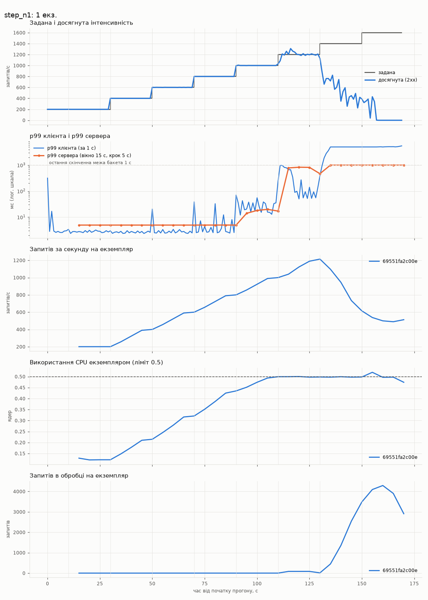
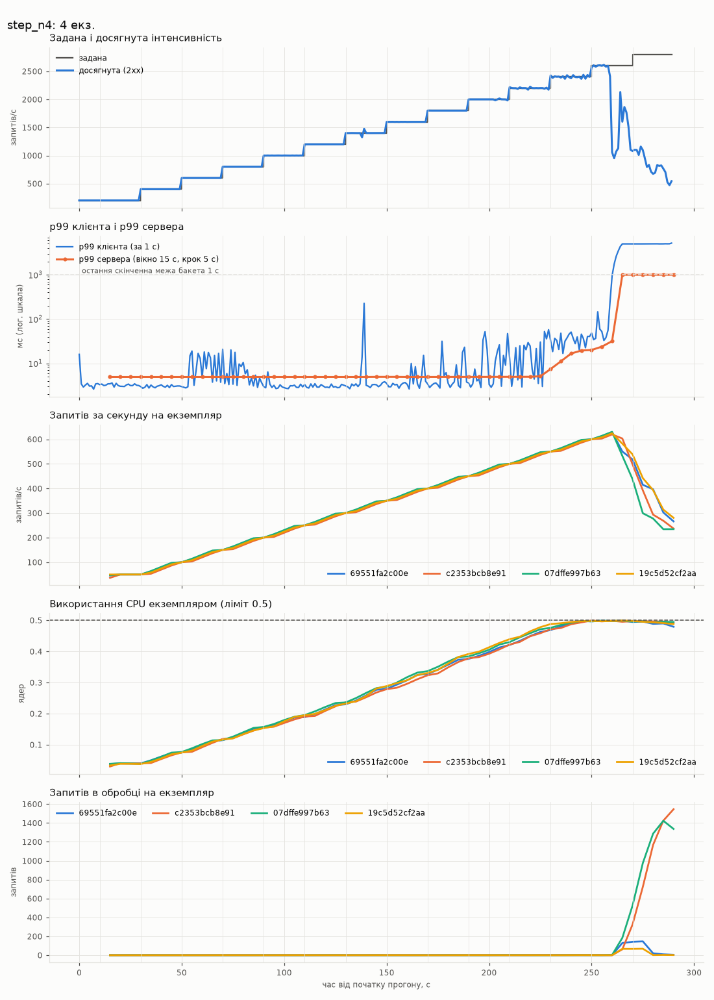
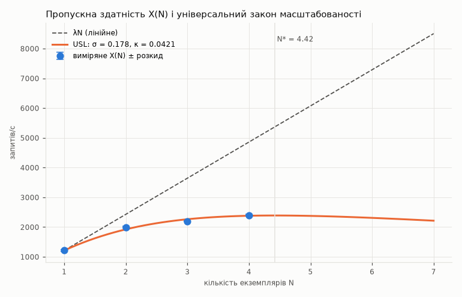
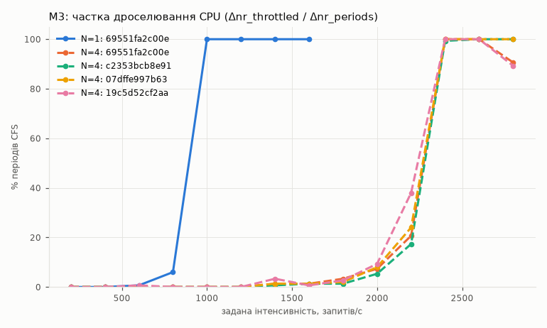

<div align="center">

# Лабораторна робота №2
## «Метрики сервісу і межа масштабованості»

Дисципліна: «Високопродуктивні розподілені обчислювальні системи»

**Варіант №25**

</div>

| | |
|---|---|
| **Виконав:** | студент Тарасенко І.О. |

---

## Зміст

- [Параметри варіанта 25](#параметри-варіанта-25)
- [Тестовий стенд](#тестовий-стенд)
- [Кроки 1–2. Метрики, /livez, X-Pod, пул зʼєднань](#кроки-12-метрики-livez-x-pod-пул-зʼєднань)
- [Крок 3. Коректна зупинка](#крок-3-коректна-зупинка)
- [Крок 4. Prometheus у стенді](#крок-4-prometheus-у-стенді)
- [Крок 5. Ступінчастий генератор](#крок-5-ступінчастий-генератор)
- [Крок 6. Межа генератора G](#крок-6-межа-генератора-g)
- [Крок 7. Серія на 1–4 екземплярах](#крок-7-серія-на-14-екземплярах)
- [Крок 8. Діаграми прогонів на 1 і 4 екземплярах](#крок-8-діаграми-прогонів-на-1-і-4-екземплярах)
- [Крок 9. p99 клієнта і p99 сервера](#крок-9-p99-клієнта-і-p99-сервера)
- [Крок 10. Універсальний закон масштабованості](#крок-10-універсальний-закон-масштабованості)
- [Крок 11. Спільний ресурс і додаткова метрика М3](#крок-11-спільний-ресурс-і-додаткова-метрика-м3)
- [Що виправлено під час налаштування і вимірювань](#що-виправлено-під-час-налаштування-і-вимірювань)
- [Висновки](#висновки)
- [Інструкція запуску](#інструкція-запуску)
- [Використання генеративних моделей](#використання-генеративних-моделей)

---

## Параметри варіанта 25

| Параметр | Значення |
|---|---|
| Ліміти контейнера web (з ЛР 1, не змінювались) | 0.5 CPU, 512 МБ |
| Розмір пулу зʼєднань `DB_POOL_SIZE` | **10** |
| Набір бакетів гістограми | **Г1**: 5, 10, 25, 50, 100, 250, 500, 1000 мс |
| Додаткова метрика | **М3**: `nr_periods` і `nr_throttled` з `cpu.stat` контрольної групи контейнера як лічильники; частка дроселювання = Δnr_throttled / Δnr_periods |
| Сценарій навантаження | `GET /trial-participants/{id}`, id випадково зі 100 записів (`loadtest/seed.py`) |

## Тестовий стенд

| Параметр | Значення |
|---|---|
| Процесор | 12th Gen Intel® Core™ i5-12450H: 8 ядер (4 продуктивні з Hyper-Threading + 4 енергоефективні), 12 потоків |
| RAM | 15.7 ГБ |
| ОС | Windows 11 Pro |
| Docker | Docker Desktop (WSL 2), Engine 29.8.2, ядро `6.18.54.1-microsoft-standard-WSL2` |
| **Виділено Docker** | **12 CPU, 7.61 ГіБ RAM** (8 173 432 832 байт, `docker info`) |
| Ліміти web (`docker inspect`) | `NanoCpus=500000000` (0.5 CPU), `Memory=536870912` (512 МБ) |
| Генератор | з хоста: Windows, Python 3.12.3, 4 процеси, звертається до `http://localhost:8080` |

Генератор і стенд працюють на одній машині. Дані: `results/lab2/host.json`, журнал усіх вимірювань —
`results/lab2/logs/lab2.log`.

---

## Кроки 1–2. Метрики, /livez, X-Pod, пул зʼєднань

**Бібліотека:** `prometheus-client==0.21.1` (`requirements.txt`). Метрики реєструються один раз під
час імпорту `app/metrics.py` (тобто під час запуску сервісу) і оновлюються в чистому ASGI-обробнику
`MetricsMiddleware`, підключеному останнім, тобто зовнішнім шаром:

| Метрика | Тип | Мітки | Призначення |
|---|---|---|---|
| `http_requests_total` | лічильник | `method`, `path`, `code` | запити за кодом відповіді |
| `http_request_duration_seconds` | гістограма, бакети Г1 у секундах (`0.005 … 1.0`) | `method`, `path` | тривалість обробки |
| `http_requests_in_progress` | вимірювач | — | запити в обробці (без самого `/metrics`, інакше кожен збір додавав би 1) |
| `cgroup_cpu_nr_periods_total`, `cgroup_cpu_nr_throttled_total`, `cgroup_cpu_throttled_seconds_total` | лічильники (М3) | — | з `cpu.stat` власної контрольної групи (cgroup v2 `/sys/fs/cgroup/cpu.stat`, cgroup v1 `/sys/fs/cgroup/cpu,cpuacct/cpu.stat`) |
| `process_cpu_seconds_total`, `process_resident_memory_bytes` | стандартний `ProcessCollector` | — | CPU і памʼять процесу |
| `app_pod_info{pod}` | вимірювач = 1 | `pod` | звʼязок адреси цілі Prometheus з іменем екземпляра |

Мітка `path` — **шаблон** маршруту (`scope["route"].path`, його заповнює FastAPI під час
маршрутизації): `/trial-participants/{participant_id}`, а не `/trial-participants/42`. Запити поза
маршрутами мають `path="<unmatched>"`. Фрагмент `GET /metrics`:

```text
http_requests_total{code="200",method="GET",path="/trial-participants/{participant_id}"} 1.0
http_requests_total{code="400",method="GET",path="/trial-participants/{participant_id}"} 1.0
http_requests_total{code="404",method="GET",path="<unmatched>"} 1.0
http_request_duration_seconds_bucket{le="0.005",method="GET",path="/healthz"} 2.0
...
http_request_duration_seconds_bucket{le="1.0",method="GET",path="/healthz"} 2.0
http_request_duration_seconds_bucket{le="+Inf",method="GET",path="/healthz"} 2.0
http_requests_in_progress 0.0
cgroup_cpu_nr_periods_total 93.0
cgroup_cpu_nr_throttled_total 10.0
cgroup_cpu_throttled_seconds_total 0.47565302
```

Інші зміни сервісу:

* `GET /livez` → `200 {"status":"alive","instance":...}` без звернення до бази; `/healthz`
  лишився перевіркою готовності з запитом до бази;
* імʼя екземпляра — змінна `POD_NAME`, а якщо її не задано — hostname контейнера; передається в
  заголовку **`X-Pod`** кожної відповіді (і в `X-Instance` для скриптів ЛР 1). У Compose `POD_NAME`
  не задано: з `--scale` у всіх реплік було б однакове значення, тому працює hostname
  (`69551fa2c00e`, `c2353bcb8e91`, …);
* `DB_POOL_SIZE=10` → `asyncpg.create_pool(max_size=10)`: пул asyncpg не відкриває зʼєднань понад
  `max_size`, тобто переповнення немає; `min_size = min(DB_POOL_MIN, DB_POOL_SIZE)`;
* сервіс — один процес у контейнері (`python -m app.serve`, один воркер uvicorn).

---

## Крок 3. Коректна зупинка

`CMD` у exec-формі і точка входу `app/serve.py`:

```dockerfile
CMD ["python", "-m", "app.serve"]          # PID 1 — процес Python, SIGTERM отримує сервіс
```

Послідовність за SIGTERM:

1. uvicorn закриває сокет, що слухає (нові зʼєднання не приймаються), і простоювані keep-alive
   зʼєднання;
2. чекає завершення запитів в обробці не довше `SHUTDOWN_TIMEOUT = 20 с`;
3. завершальна частина lifespan закриває пул зʼєднань з базою;
4. процес завершується з кодом 0.

У `docker-compose.yml`: `stop_signal: SIGTERM`, `stop_grace_period: 30s` (більше за 20 с очікування в
сервісі). У nginx: `proxy_connect_timeout 1s`, `proxy_next_upstream error timeout`,
`proxy_next_upstream_tries 3` — запит, що потрапив на екземпляр, який уже закрив сокет,
повторюється на іншому.

Чому знадобився `app/serve.py`, а не `CMD ["uvicorn", ...]`, — див.
[Що виправлено](#що-виправлено-під-час-налаштування-і-вимірювань), пункт 1.

**Перевірка під навантаженням** (`py loadtest/lab2.py stop-test`, `results/lab2/stop_test.json`):
2 екземпляри, 5 с розгону на 200 rps, далі постійні **750 rps** (≈ 60 % X(1), щоб один екземпляр
витримав усе навантаження після зупинки); `docker stop trials-web-2` на 15.2-й секунді.

| Показник | Значення |
|---|---|
| `docker inspect --format '{{.State.ExitCode}}'` | **0** |
| Від `docker stop` до завершення контейнера | 0.63 с |
| Вікно 10 с навколо зупинки (10–20 с) | **7 500 відповідей 2xx, 0 не 2xx, 0 помилок зʼєднання** |
| Найбільший посекундний p99 у вікні | 34.7 мс |
| Увесь 40-секундний прогін | 0 не 2xx, 0 помилок зʼєднання; 22 870 і 4 382 відповіді від двох екземплярів |

Журнал зупиненого контейнера (`docker logs`):

```text
INFO:     Shutting down
INFO:     Waiting for application shutdown.
2026-10-29 18:25:44,315 INFO app: instance=c2353bcb8e91: connection pool closed
INFO:     Application shutdown complete.
INFO:     Finished server process [1]
2026-10-29 18:25:44,315 INFO app.serve: signal SIGTERM handled: graceful shutdown complete
```

---

## Крок 4. Prometheus у стенді

```yaml
# prometheus/prometheus.yml
global:
  scrape_interval: 5s
  scrape_timeout: 4s
  evaluation_interval: 5s
scrape_configs:
  - job_name: web
    metrics_path: /metrics
    dns_sd_configs:
      - names: [web]
        type: A
        port: 8000
        refresh_interval: 5s
  - job_name: prometheus
    static_configs:
      - targets: ["localhost:9090"]
```

```yaml
# docker-compose.yml (додано)
  prometheus:
    image: prom/prometheus:v2.53.2
    command:
      - --config.file=/etc/prometheus/prometheus.yml
      - --storage.tsdb.path=/prometheus
      - --storage.tsdb.retention.time=15d
      - --web.enable-lifecycle
    volumes:
      - ./prometheus/prometheus.yml:/etc/prometheus/prometheus.yml:ro
      - promdata:/prometheus                  # іменований том
    ports:
      - "${PROMETHEUS_PORT:-9090}:9090"
    networks: [frontend]
volumes:
  promdata: {}
```

Метрику М3 знімає сам сервіс, тож окремий експортер не потрібен. Після кожної зміни кількості
екземплярів `lab2.py` виконує `docker compose up -d --scale web=N`, перезапускає балансувальник
(`docker compose restart lb`) і чекає, доки в `/api/v1/targets` (сторінка Targets) буде рівно N
цілей `web` у стані UP. Перед кожним прогоном серії (`results/lab2/logs/lab2.log`):

```text
   Prometheus Targets web: 172.19.0.3:8000=up
   Prometheus Targets web: 172.19.0.3:8000=up, 172.19.0.5:8000=up
   Prometheus Targets web: 172.19.0.3:8000=up, 172.19.0.5:8000=up, 172.19.0.6:8000=up
   Prometheus Targets web: 172.19.0.6:8000=up, 172.19.0.7:8000=up, 172.19.0.3:8000=up, 172.19.0.5:8000=up
```

З `--scale web=4` усі чотири екземпляри web мають стан UP.

---

## Крок 5. Ступінчастий генератор

`loadtest/stepgen.py` (стандартна бібліотека Python):

* **профіль:** прогрів 10 с на 200 rps, далі сходинки по 20 с від 200 rps з кроком 200 rps; зупинка —
  дві сходинки поспіль із досягнутою < 0.9 заданої, або після сходинки, задана інтенсивність якої
  досягла G;
* **асинхронний клієнт:** 4 процеси, у кожному — цикл `asyncio` і мінімальний HTTP/1.1-клієнт з
  keep-alive. Запит відправляється в запланований момент `a + (idx + j·P)/R` незалежно від того,
  скільки попередніх ще чекають відповіді: береться вільне зʼєднання або відкривається нове (до
  4 000 сумарно; понад це запит чекає зʼєднання, а затримка однаково рахується від запланованого
  моменту). Моменти відміряє окремий потік через `time.sleep`, який на Windows має таймер високої
  роздільності; запит ніколи не відправляється раніше свого моменту;
* **затримка** рахується від запланованого моменту до відповіді; **тайм-аут 5 с**, після нього
  запит — відповідь не 2xx;
* **посекундний запис** (`results/lab2/raw/<run>_seconds.csv`): задана інтенсивність, фактична
  інтенсивність надсилання, досягнута (2xx, завершені в цю секунду), кількість 2xx, не 2xx,
  тайм-аутів і помилок зʼєднання, p50/p95/p99 клієнта, p99 запізнення відправки, CPU генератора;
* **на сходинку** — середнє досягнутої за останні 15 с (перші 5 с перехідні), розкид — стандартне
  відхилення посекундної досягнутої за ті самі 15 с.

**Точність генератора.** На всіх сходинках до межі сервісу фактична інтенсивність надсилання
дорівнює заданій (відхилення ≤ 0.07 rps), а p99 запізнення відправки відносно розкладу —
**≈ 1 мс** (колонка «Запізн. відпр. p99» у `results/lab2/analysis.md`). На кількох сходинках
600–800 rps (N = 2–4) запізнення доходило до 6–18 мс у поодиноких секундах — це короткі паузи на хості, вони видно і в
p99 клієнта на цих сходинках.

---

## Крок 6. Межа генератора G

`location = /noop { return 204; }` у nginx, той самий опублікований порт 8080, прогін без
обмеження G (`results/lab2/raw/step_noop.json`, повна таблиця — `results/lab2/analysis.md`):

| Задана, rps | Досягнута, rps | Розкид | p50, мс | p99, мс | не 2xx, % | помилки зʼєдн. |
|---:|---:|---:|---:|---:|---:|---:|
| 200 | 200.0 | 0.00 | 1.36 | 2.24 | 0.0 | 0 |
| 2 000 | 2 000.07 | 0.80 | 0.74 | 1.28 | 0.0 | 0 |
| 5 000 | 4 999.93 | 0.96 | 0.76 | 1.24 | 0.0 | 0 |
| 8 000 | 8 000.13 | 1.68 | 0.86 | 1.43 | 0.0 | 0 |
| 9 400 | 9 399.73 | 1.94 | 0.96 | 1.57 | 0.0 | 0 |
| **9 600** | **9 600.00** | 2.48 | 0.97 | 1.61 | 0.0 | 0 |
| 9 800 | 7 879.60 | 1 782.97 | 538.47 | 4 716.72 | 0.7 | 32 424 |
| 10 000 | 8 593.07 | 202.67 | 1.36 | 5 458.54 | 6.1 | 11 876 |

**G = 9 600 rps.** На 9 800 і 10 000 rps досягнута інтенсивність двічі поспіль нижча за 0.9 заданої, і
зʼявляються десятки тисяч помилок зʼєднання. Процеси генератора на 9 600 rps займали ≈ 2 ядра хоста.
0.9·G = 8 640 rps — значно вище за будь-яке X(N), тож генератор не обмежує жодну точку серії.

---

## Крок 7. Серія на 1–4 екземплярах

`py loadtest/lab2.py series` (G = 9 600). Величини сервера — з сирих зразків Prometheus на
15-секундному вікні сходинки, на якій досягнуто X(N):

| N | X(N), rps | Розкид, rps | Сходинка, rps | p99 клієнта, мс | p99 сервера, мс | Бакет p99 сервера, мс | не 2xx, % | CPU одного екземпляра, ядер | В обробці на екземпляр | Дроселювання, % | Обмежено генератором |
|---:|---:|---:|---:|---:|---:|---|---:|---:|---:|---:|---|
| 1 | **1 214.8** | 33.72 | 1 200 | 378.4 | 468.1 | (250; 500] | 0.0 | 0.498 | 12.67 | 100.0 | ні |
| 2 | **1 999.0** | 32.22 | 2 000 | 108.4 | 182.8 | (100; 250] | 0.0 | 0.496 | 0.67 | 100.0 | ні |
| 3 | **2 200.1** | 9.11 | 2 200 | 51.2 | 68.2 | (50; 100] | 0.0 | 0.497 | 2.33 | 100.0 | ні |
| 4 | **2 400.0** | 25.16 | 2 400 | 39.2 | 20.1 | (10; 25] | 0.0 | 0.498 | 0.75 | 99.8 | ні |

Жодна точка не обмежена генератором: X(N) ≤ 2 400 < 0.9·G = 8 640, і в кожному прогоні дві останні
сходинки мали досягнуту < 0.9 заданої. Отже, ліміт CPU web зменшувати не довелось.

**Ресурси, виділені Docker:** 12 CPU, 7.61 ГіБ RAM.

Розподіл між екземплярами рівний (запитів/с на сходинці X(N), Prometheus): N = 2 — 999.9 і 999.9;
N = 3 — 733.2, 733.3, 733.2; N = 4 — 600.0, 600.1, 600.0, 600.0.

На кожному N у точці X(N) екземпляри використовують ≈ 0.50 ядра, тобто весь свій ліміт, і
дроселюються в 100 % періодів CFS. Після X(N) прогін переходить у перевантаження: черга росте,
відповіді приходять після тайм-ауту 5 с, генератор відкриває нові зʼєднання і отримує тисячі помилок
зʼєднання (на 1 екземплярі на 1 400 rps — 37.6 % не 2xx і 8 862 помилки зʼєднання, на 1 600 rps —
досягнута 52 rps). Усі сходинки кожного прогону — `results/lab2/analysis.md`.

---

## Крок 8. Діаграми прогонів на 1 і 4 екземплярах

Дані Prometheus експортовано сирими зразками (кожен збір) у `results/lab2/prom/*.json.gz` до
видалення томів, тож діаграми відтворюються без Prometheus (`py loadtest/lab2_analyze.py`).
p99 сервера — за вікно 15 с з оновленням кожні 5 с.

**1 екземпляр**



**4 екземпляри**



Що видно:

* **N = 1.** CPU екземпляра росте приблизно лінійно з навантаженням і на сходинці 1 000 rps
  упирається в ліміт 0.5 ядра. На 1 000–1 200 rps p99 обох видів зростає від одиниць до сотень
  мілісекунд. На 1 400 rps черга розростається без меж: тисячі запитів в обробці, досягнута
  інтенсивність падає;
* **N = 4.** Чотири екземпляри навантажені однаково (лінії майже збігаються), CPU кожного досягає
  0.5 ядра на 2 400 rps, тобто при ≈ 600 rps на екземпляр — удвічі меншій інтенсивності, ніж один
  екземпляр у прогоні N = 1. На 2 600 rps черга росте на всіх екземплярах одночасно.

---

## Крок 9. p99 клієнта і p99 сервера

Прогін на одному екземплярі. p99 сервера — за приростами лічильників бакетів на 15-секундному вікні
сходинки: ранг r = 0.99·n, лінійна інтерполяція в бакеті (b(i−1); b(i)], максимальна похибка — ширина
бакета.

| Задана, rps | p99 клієнта, мс | p99 сервера, мс | Бакет, мс | Макс. похибка, мс | Спостережень |
|---:|---:|---:|---|---:|---:|
| 200 | 2.86 | 4.9 | (0; 5] | 5 | 3 000 |
| 400 | 2.75 | 5.0 | (0; 5] | 5 | 5 999 |
| 600 | 2.83 | 5.0 | (0; 5] | 5 | 8 999 |
| 800 | 3.60 | 5.0 | (0; 5] | 5 | 12 000 |
| 1 000 | 33.20 | 17.1 | (10; 25] | 15 | 14 999 |
| 1 200 | 378.41 | 468.1 | (250; 500] | 250 | 18 214 |
| 1 400 | 4 990.38 | **> 1000** | (1000; +Inf] | не обмежена | 9 220 |
| 1 600 | 5 328.97 | **> 1000** | (1000; +Inf] | не обмежена | 7 689 |

Підстановка для 1 000 rps: n = 14 999, r = 0.99 · 14 999 = 14 849; c(10 мс) < r ≤ c(25 мс), тому
Q = 10 + 15 · (r − c(10)) / (c(25) − c(10)) = 17.1 мс.

* **200–800 rps.** p99 клієнта 2.8–3.6 мс, а оцінка сервера 4.9–5.0 мс — **більша** за клієнтську,
  хоча клієнт бачить ще й мережу та nginx. Причина — грубий перший бакет Г1: r потрапляє в (0; 5] мс
  поруч із верхньою межею, і інтерполяція дає ≈ b(1) = 5 мс. Справжній p99 сервера, ймовірно,
  менший за клієнтський (до ≈ 3 мс), але гістограма цього не показує: похибка оцінки (5 мс) більша
  за саме значення;
* **1 000 rps.** p99 клієнта 33.2 мс проти 17.1 ± 15 мс на сервері. Різниця — час, якого сервер не
  бачить: очікування в черзі прийому зʼєднань і в буфері сокета перед uvicorn, поки процес
  обмежений квотою CFS (дроселювання на цій сходинці вже 100 %), а також nginx і мережа;
* **1 200 rps.** 378 мс у клієнта проти 468 ± 250 мс на сервері: значення лежать в одному бакеті
  шириною 250 мс, тож гістограма Г1 не дає їх розрізнити;
* **1 400–1 600 rps.** p99 сервера лежить за останньою скінченною межею b(k) = 1 с: оцінка лише
  «> 1000 мс» без верхньої межі похибки. p99 клієнта ≈ 5 с — тайм-аут генератора.

---

## Крок 10. Універсальний закон масштабованості

λ = X(1) = 1 214.8 rps; у підбір входять усі N > 1 (жодна точка не обмежена генератором).

| N | X(N), rps | C(N) = X(N)/X(1) | u = N − 1 | v = N(N − 1) | y = N/C − 1 |
|---:|---:|---:|---:|---:|---:|
| 1 | 1 214.8 | 1.0000 | 0 | 0 | 0 |
| 2 | 1 999.0 | 1.6455 | 1 | 2 | 0.2154 |
| 3 | 2 200.1 | 1.8111 | 2 | 6 | 0.6565 |
| 4 | 2 400.0 | 1.9756 | 3 | 12 | 1.0247 |

Суми: Σu² = 14, Σv² = 184, Σuv = 50, Σuy = 4.6024, Σvy = 16.6658;
Σu²·Σv² − (Σuv)² = 14·184 − 50² = 76.

σ = (Σv²·Σuy − Σuv·Σvy) / 76 = (184·4.6024 − 50·16.6658) / 76 = (846.84 − 833.29) / 76 = **0.1783**

κ = (Σu²·Σvy − Σuv·Σuy) / 76 = (14·16.6658 − 50·4.6024) / 76 = (233.32 − 230.12) / 76 = **0.0421**

Обидві оцінки додатні, корекція не потрібна.

**N\* = √((1 − σ)/κ) = √(0.8217 / 0.0421) = 4.42**

Перевірка підбором: X(2) = 2·1 214.8 / (1 + 0.178 + 0.084) = 1 925 (виміряно 1 999),
X(3) = 3 644.4 / (1 + 0.357 + 0.253) = 2 264 (2 200), X(4) = 4 859.2 / (1 + 0.535 + 0.505) = 2 382 (2 400).



Модель прогнозує максимум X ≈ 2 390 rps при N\* ≈ 4.4, тобто п'ятий екземпляр уже не дав би приросту.
Обидва члени відмінні від нуля: σ = 0.18 означає, що близько 18 % роботи не масштабується (спільна
частина на хості), κ = 0.042 — що кожен доданий екземпляр робить роботу інших дорожчою. Звідки це
береться фізично — у кроці 11.

---

## Крок 11. Спільний ресурс і додаткова метрика М3

**Ресурси на сходинці X(4)** (задана 2 400 rps; середнє `docker stats --no-stream` за сходинку,
генератор — за `time.process_time()` його процесів; 100 % = 1 ядро):

| Контейнер | CPU, % | Памʼять |
|---|---:|---|
| trials-web-1 | 49.0 | 122 МіБ / 512 МіБ |
| trials-web-2 | 47.9 | 87.2 МіБ / 512 МіБ |
| trials-web-3 | 48.6 | 69.6 МіБ / 512 МіБ |
| trials-web-4 | 48.5 | 44.1 МіБ / 512 МіБ |
| trials-db-1 (PostgreSQL) | 50.5 | 92.9 МіБ |
| trials-lb-1 (nginx) | 32.5 | 90.8 МіБ |
| trials-prometheus-1 | 0.1 | 42.4 МіБ |
| генератор (процеси на Windows) | 102.0 | — |
| **Разом** | **≈ 379** | |

**Додаткова метрика М3 — частка дроселювання CPU** (Δnr_throttled / Δnr_periods за 15-секундне вікно
кожної сходинки, `results/lab2/charts/m3_throttle.png`):



| Задана, rps | N = 1 | N = 4 (4 екземпляри) |
|---:|---:|---|
| 200–400 | 0.0 % | 0.0 % |
| 600 | 0.7 % | 0.0–0.7 % |
| 800 | 6.0 % | 0.0 % |
| 1 000 | **100 %** | 0.0 % |
| 1 200 | 100 % | 0.0 % |
| 1 400 | 100 % | 0.7–3.3 % |
| 1 600–1 800 | 100 % | 0.7–3.3 % |
| 2 000 | — | 5.3–9.3 % |
| 2 200 | — | 17–38 % |
| 2 400 | — | **99.3–100 %** |
| 2 600–2 800 | — | 89–100 % |

**Процесорний час на запит** (CPU з `docker stats` / досягнута інтенсивність):

| N | Сходинка, rps | Запитів/с на екземпляр | web, мс CPU на запит | db, мс | nginx, мс | Разом CPU стенда і генератора, ядер |
|---:|---:|---:|---:|---:|---:|---:|
| 1 | 1 200 (X) | 1 215 | 0.403 | 0.147 | 0.090 | 1.12 |
| 2 | 1 200 | 600 | 0.635 | 0.158 | 0.102 | 1.44 |
| 2 | 2 000 (X) | 1 000 | 0.485 | 0.186 | 0.098 | 2.12 |
| 3 | 1 200 | 400 | 0.698 | 0.157 | 0.117 | 1.54 |
| 3 | 2 200 (X) | 733 | 0.658 | 0.191 | 0.124 | 2.96 |
| 4 | 1 200 | 300 | 0.771 | 0.167 | 0.129 | 1.68 |
| 4 | 2 400 (X) | 600 | 0.808 | 0.210 | 0.135 | 3.79 |

**Висновок про спільний ресурс — процесор хоста, але не кількість ядер, а їхня продуктивність.**

1. **Безпосередня межа кожного N — квота контейнера web.** У точці X(N) на всіх N кожен екземпляр
   використовує 0.50 ядра і дроселюється в 99.8–100 % періодів (М3). Тобто екземпляри не простоюють
   через базу чи балансувальник, а впираються у власний ліміт 0.5 CPU.
2. **Але квота вичерпується на дедалі меншій інтенсивності на екземпляр:** 1 215 rps при N = 1,
   1 000 при N = 2, 733 при N = 3, 600 при N = 4. Причина — процесорний час web на один запит
   **зростає з N**: на тій самій сумарній сходинці 1 200 rps — 0.40 → 0.64 → 0.70 → 0.77 мс, а
   в точці X(4) — 0.81 мс, удвічі більше, ніж у X(1). Якби кожен запит коштував стільки ж, скільки
   при N = 1, чотири екземпляри дали б ≈ 4 × 1 215 ≈ 4 860 rps, а не 2 400.
3. **Це не база і не nginx.** PostgreSQL на X(4) використовує 0.50 ядра, nginx — 0.32; обидва далеко
   від насичення, CPU на запит у них зростає лише на 30–50 %. Запитів в обробці на екземпляр ≤ 1–2
   при пулі 10 зʼєднань — пул не вичерпаний. Сам Docker має 12 CPU, а весь стенд разом із
   генератором використовує ≈ 3.8 ядра.
4. **Що робить запит дорожчим.** Процесор i5-12450H має лише 4 продуктивні ядра з Hyper-Threading
   (8 потоків) і 4 повільніші енергоефективні ядра. На X(4) одночасно активні 4 процеси web, процеси
   PostgreSQL, воркери nginx, 4 процеси генератора і мережевий проксі Docker Desktop. Потоки
   змушені ділити фізичні ядра з сусідами по Hyper-Threading або потрапляють на E-ядра, і кожна
   секунда CPU виконує менше роботи. Друга складова — розрідження потоку: з ростом N кожен
   екземпляр отримує менше запитів за одне пробудження циклу подій, і фіксовані витрати на
   пробудження (epoll, системні виклики) діляться на менше запитів. Розділити ці дві складові в
   рамках серії не вдалося, але обидві — витрати на спільне використання процесора хоста, що
   зростають із кількістю екземплярів. Саме цю поведінку описує κ = 0.042 у кроці 10.

---

## Що виправлено під час налаштування і вимірювань

1. **Код завершення 143 замість 0.** Перша версія лишала `CMD ["uvicorn", ...]` з ЛР 1: uvicorn
   обробляє SIGTERM коректно (не приймає нових зʼєднань, дочікується запитів, закриває пул), але,
   починаючи з версії 0.29, після зупинки повторно надсилає собі перехоплений сигнал
   (`signal.raise_signal` у `Server.capture_signals`). Процес завершувався сигналом SIGTERM, і Docker
   показував 143. Перевірка (`results/lab2/sigterm_check.md`): `uvicorn app.main:app` → 143,
   `python -m app.serve` → 0. Виправлено точкою входу `app/serve.py`: вона запускає `uvicorn.Server`
   програмно і **до запуску** встановлює власний обробник SIGTERM, тож після зупинки uvicorn
   відновлює саме його.
2. **Вимірювач «в обробці» рахував сам `/metrics`.** Запит збору завжди «в обробці» в момент збору, і
   кожне значення було ≥ 1. `/metrics` виключено з вимірювача.
3. **«Обвал» генератора на `/noop`.** Під час налагодження скриптів генератор без обмеження кількості
   зʼєднань на 3 200 rps відкрив понад 10 000 зʼєднань (nginx: `16384 worker_connections are not
   enough`), а черга очікування зʼєднань була списком з `pop(0)`, тож генератор захлинувся сам.
   Додано обмеження (4 000 зʼєднань) і чергу `deque`.
4. **Відʼємні затримки на Windows — перша серія вимірювань відкинута.** У першому повному прогоні на
   Docker p50 на `/noop` вийшов −4 мс, а p95 клієнта навіть на 200 rps був ≈ 17–20 мс при p99 сервера
   < 5 мс. Причина: у Python 3.12 на Windows годинник циклу подій `asyncio` має роздільність
   15.6 мс, і `asyncio.sleep` прокидається до 15 мс раніше або пізніше. Запити відправлялись раніше
   запланованого моменту, і затримка «від запланованого моменту» спотворювалась. Виправлено: моменти
   відправки відміряє окремий потік через `time.sleep` (таймер високої роздільності), запит ніколи
   не йде раніше розкладу, а запізнення відправки записується. Після виправлення p99 запізнення
   ≈ 1 мс. Усю серію знято повторно; у звіті лише повторні дані.
5. **Помилки зʼєднання на старті тесту зупинки.** Перший тест почався одразу з 850 rps, генератор
   одночасно відкривав сотні зʼєднань, і за перші 4 с було 2 135 помилок зʼєднання (поза вікном
   зупинки). Додано 5 с розгону на 200 rps; у повторному тесті помилок 0.
6. **Кодування журналу.** `Tee-Object` у PowerShell записав журнал у UTF-16 зі зламаною кирилицею.
   `lab2.py` тепер сам дублює вивід у `results/lab2/logs/lab2.log` в UTF-8.
7. **Середовище.** Перед першим запуском не був запущений Docker Desktop (`failed to connect to the
   docker API at npipe:////./pipe/dockerDesktopLinuxEngine`), а для діаграм не вистачало
   `matplotlib` (`py -m pip install matplotlib`).
8. **Налагодження без Docker.** Скрипти спершу перевірено на емуляції стенда без Docker на машині з
   2 CPU (`scripts/emu_stand.py`: ті самі процеси, web у cgroup з квотою 0.5 CPU). На ній знайдено
   пункти 1–3; числа з емуляції у звіт не входять.

---

## Висновки

1. Сервіс віддає метрики Prometheus (лічильник, гістограма Г1, вимірювач запитів в обробці, М3 з
   `cpu.stat`), має `/livez`, заголовок `X-Pod` і пул `DB_POOL_SIZE = 10` без переповнення.
2. Коректна зупинка: `docker stop` → код **0**, за 10 с навколо зупинки під навантаженням 750 rps —
   **0** відповідей не 2xx і **0** помилок зʼєднання.
3. Prometheus знаходить екземпляри через `dns_sd_configs`; з `--scale web=4` усі 4 цілі UP.
4. G = 9 600 rps; X(1) = 1 215, X(2) = 1 999, X(3) = 2 200, X(4) = 2 400 rps; жодна точка не
   обмежена генератором.
5. USL: σ = 0.178, κ = 0.042, N\* = 4.42 — п'ятий екземпляр на цьому стенді вже не дав би приросту.
6. Безпосередня межа кожного екземпляра — його квота 0.5 CPU (дроселювання М3 у точці X(N) —
   100 %). Масштабування гальмує спільний процесор хоста: процесорний час на запит у web зростає з
   0.40 мс (N = 1) до 0.81 мс (N = 4), тому чотири екземпляри дають лише 2× пропускної здатності
   одного. База (0.5 ядра) і nginx (0.3 ядра) спільним вузьким місцем не є.
7. Гістограма Г1 занадто груба для цього сервісу: p99 < 5 мс потрапляє в перший бакет з похибкою
   ±5 мс, а на межі насичення — в бакет шириною 250 мс. Бакети 1–2 мс (Г2/Г3) дали б точнішу
   оцінку.

---

## Інструкція запуску

```powershell
docker compose up -d --build                     # db, migrate, web, lb, prometheus
py loadtest/seed.py                              # 100 записів
py loadtest/lab2.py all                          # host, G, серія 1..4, зупинка, експорт Prometheus
py -m pip install matplotlib                     # один раз, для діаграм
py loadtest/lab2_analyze.py                      # results/lab2/analysis.md і діаграми
```

Сторінка Targets: `http://localhost:9090/targets`.

| Що | Де |
|---|---|
| Метрики, М3 | `app/metrics.py`, `GET /metrics` |
| Живучість | `GET /livez` |
| Коректна зупинка | `app/serve.py`, `Dockerfile` (`CMD`), `docker-compose.yml` (`stop_grace_period`) |
| Конфігурація Prometheus | `prometheus/prometheus.yml` |
| Ступінчастий генератор | `loadtest/stepgen.py` |
| Оркестратор вимірювань | `loadtest/lab2.py` |
| Аналіз, USL, діаграми | `loadtest/lab2_analyze.py` |
| Сирі дані генератора | `results/lab2/raw/` |
| Сирі ряди Prometheus | `results/lab2/prom/` |
| Таблиці всіх сходинок | `results/lab2/analysis.md`, `analysis.json` |
| Діаграми | `results/lab2/charts/` |
| Тест зупинки | `results/lab2/stop_test.json` |
| Журнал вимірювань | `results/lab2/logs/lab2.log` |

---

## Використання генеративних моделей

Код метрик, генератора, оркестратора, аналізу і стенда-емуляції написано з допомогою Claude. Моделі
не довіряв без перевірки: кожну зміну перевіряв вимірюванням. Помилки, знайдені так (усі в розділі
[Що виправлено](#що-виправлено-під-час-налаштування-і-вимірювань)): код 143 замість 0, вимірювач з
`/metrics`, «обвал» генератора і відʼємні затримки на Windows — через останню довелося повністю
перезняти серію. Підбір USL перераховано вручну (підстановки в кроці 10 збігаються з
`results/lab2/analysis.md`), а інтерпретацію σ і κ звірено з метриками CPU і М3, щоб не приписувати
спад масштабованості базі чи «узгодженню стану», якого в сервісі немає.
