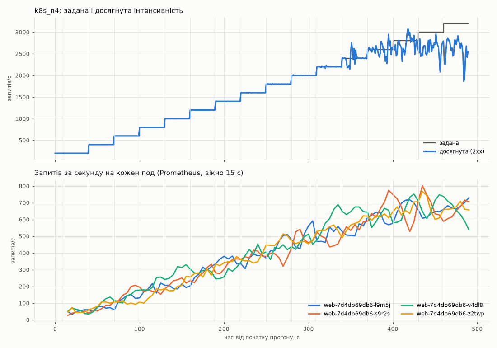
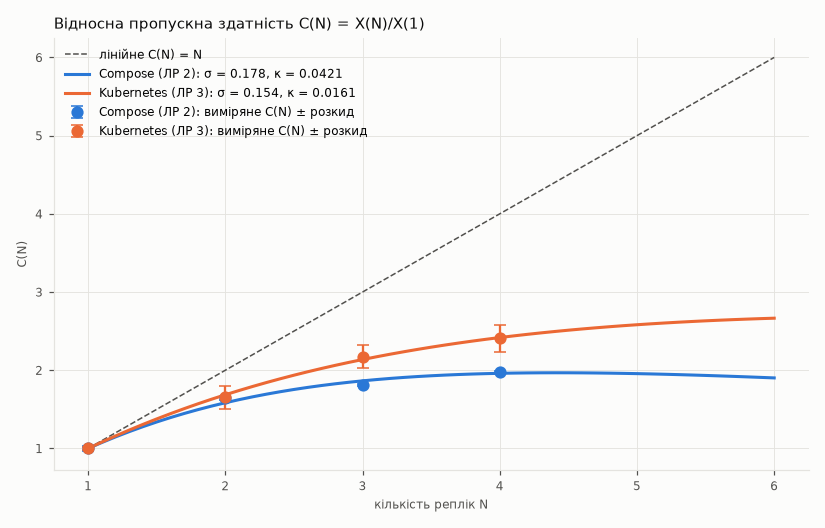
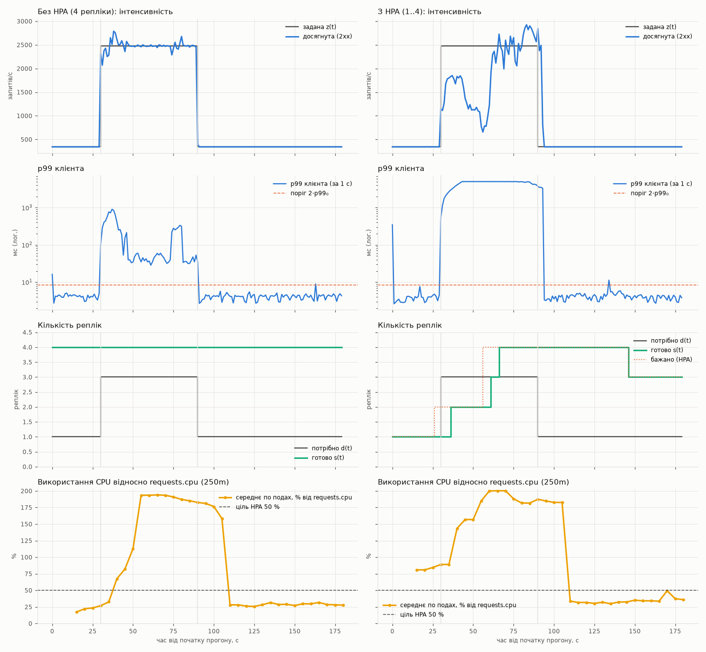

<div align="center">

# Лабораторна робота №3
## «Сервіс у Kubernetes з автомасштабуванням і без нього»

Дисципліна: «Високопродуктивні розподілені обчислювальні системи»

**Варіант №25**

</div>

| | |
|---|---|
| **Виконав:** | студент Тарасенко І.О. |

---

## Зміст

- [Параметри варіанта 25](#параметри-варіанта-25)
- [Тестовий стенд](#тестовий-стенд)
- [Кроки 1–2. Кластер і команда розгортання](#кроки-12-кластер-і-команда-розгортання)
- [Крок 3. PostgreSQL у кластері](#крок-3-postgresql-у-кластері)
- [Крок 4. Сервіс web](#крок-4-сервіс-web)
- [Крок 5. Моніторинг](#крок-5-моніторинг)
- [Крок 6. Модель зʼєднань генератора](#крок-6-модель-зʼєднань-генератора)
- [Крок 7. Серія без автомасштабування](#крок-7-серія-без-автомасштабування)
- [Крок 8. Коефіцієнт дисбалансу](#крок-8-коефіцієнт-дисбалансу)
- [Крок 9. Універсальний закон масштабованості: кластер і Compose](#крок-9-універсальний-закон-масштабованості-кластер-і-compose)
- [Кроки 10–12. Стрибок навантаження без HPA і з HPA](#кроки-1012-стрибок-навантаження-без-hpa-і-з-hpa)
- [Крок 13. Додаткова вимога Д3: Ingress проти NodePort](#крок-13-додаткова-вимога-д3-ingress-проти-nodeport)
- [Що виправлено під час налаштування і вимірювань](#що-виправлено-під-час-налаштування-і-вимірювань)
- [Висновки](#висновки)
- [Інструкція запуску](#інструкція-запуску)
- [Використання генеративних моделей](#використання-генеративних-моделей)

---

## Параметри варіанта 25

| Параметр | Значення |
|---|---|
| Кластер | **k3d** (1 server + 2 agent) |
| Найбільша кількість реплік R = 3 + (25 mod 3) | **4** |
| requests / limits CPU контейнера web | **250m / 500m**, limits.memory 512Mi |
| Цільове використання CPU для HPA | **50 %** від requests.cpu |
| Рівень стрибка | **2.5 · X(1)**, але не більше за 0.9 · X(R) |
| Розмір пулу (з ЛР 2) | DB_POOL_SIZE = **10** |
| Додаткова вимога | **Д3**: Ingress-контролер Traefik перед web; дисбаланс через NodePort і через Ingress |

## Тестовий стенд

Та сама машина, що в ЛР 2.

| Параметр | Значення |
|---|---|
| Процесор | 12th Gen Intel® Core™ i5-12450H (4 P-ядра з HT + 4 E-ядра, 12 потоків) |
| Docker | Docker Desktop (WSL 2), Engine 29.8.2; **виділено Docker: 12 CPU, 7.61 ГіБ** |
| Кластер | k3d v5.9.0, k3s **v1.31.4** (3 вузли-контейнери, кожен бачить 12 CPU хоста) |
| Моніторинг | kube-prometheus-stack 92.16.0 (Prometheus Operator v0.94.2), prometheus-postgres-exporter 8.2.0 |
| Ingress | Traefik v2.11.10, вбудований у k3s |
| Генератор | з хоста: Windows, Python 3.12.3, 4 процеси |

Дані: `results/lab3/host.json`, журнал усіх команд — `results/lab3/logs/lab3.log`, усі
таблиці — `results/lab3/analysis.md`.

---

## Кроки 1–2. Кластер і команда розгортання

`k8s/k3d-cluster.yaml`:

```yaml
apiVersion: k3d.io/v1alpha5
kind: Simple
metadata: {name: trials}
servers: 1
agents: 2
image: rancher/k3s:v1.31.4-k3s1          # >= 1.30: lifecycle.preStop.sleep
kubeAPI: {host: "127.0.0.1", hostIP: "127.0.0.1", hostPort: "6550"}
ports:
  - {port: 8080:30080, nodeFilters: [loadbalancer]}   # NodePort web
  - {port: 9090:30090, nodeFilters: [loadbalancer]}   # NodePort Prometheus
  - {port: 8081:80,    nodeFilters: [loadbalancer]}   # Traefik (Д3)
options:
  k3s:
    extraArgs:
      - arg: --node-taint=node-role.kubernetes.io/control-plane=true:NoSchedule
        nodeFilters: [server:0]
```

**Розгортання однією командою** — `scripts/k8s/deploy.ps1`:

1. `k3d cluster create --config k8s/k3d-cluster.yaml`;
2. `kubectl label node k3d-trials-server-0 role=infra`;
3. `docker build -t trials-web:lab3 .` і `k3d image import trials-web:lab3 -c trials`;
4. Secret `db-secret` з `POSTGRES_PASSWORD` файла `.env`
   (`kubectl create secret ... --dry-run=client -o yaml | kubectl apply -f -`);
5. `helm upgrade --install kps prometheus-community/kube-prometheus-stack` (спершу, бо PodMonitor
   потребує CRD);
6. база, міграція, web, PodMonitor, Ingress, postgres-exporter.

**Повне видалення** — `scripts/k8s/destroy.ps1` (`k3d cluster delete trials` разом з томами).

Вузли після розгортання:

| Вузол | Мітки | Taint |
|---|---|---|
| k3d-trials-server-0 | `role=infra`, `node-role.kubernetes.io/control-plane=true` | `control-plane=true:NoSchedule` |
| k3d-trials-agent-0 | — | — |
| k3d-trials-agent-1 | — | — |

HPA (`k8s/hpa.yaml`) свідомо не застосовується під час розгортання, а лише в кроці 11: інакше він
змінював би кількість реплік під час серії без автомасштабування.

---

## Крок 3. PostgreSQL у кластері

`k8s/db.yaml`: headless Service `db` (`clusterIP: None`, стале імʼя `db-0.db`) і StatefulSet з
`volumeClaimTemplates` (1Gi, `local-path`), `nodeSelector: {role: infra}`, toleration для taint
control-plane, `args: ["-c", "max_connections=100"]`, пароль з Secret `db-secret`. Міграція —
Job `migrate` з тим самим образом і командою `python -m app.migrate` (`k8s/migrate-job.yaml`).

**Збереження даних після `kubectl delete pod db-0`** (`py loadtest/lab3.py persist`,
`results/lab3/persistence.md`):

| Крок | Результат |
|---|---|
| `POST /trial-participants` | 201, id = 102, код `TP-PERSIST-01899`; записів у базі — 101 |
| `kubectl delete pod db-0` | под `a0d29f49-…` видалено |
| StatefulSet створив новий под | `135cdd48-…`, Ready через 3.2 с |
| PersistentVolume | той самий: `pvc-98013285-93dc-4ebc-bbec-87ca85687397` |
| `GET /trial-participants/102` | **200**, `TP-PERSIST-01899` |
| Кількість записів | 101 (не змінилась) |

---

## Крок 4. Сервіс web

`k8s/web.yaml`, `k8s/web-config.yaml`:

* Deployment **без поля `replicas`** — кількість задають `kubectl scale` або HPA, і повторне
  `kubectl apply` її не скидає; Service типу NodePort (30080);
* ConfigMap `web-config`: `DB_HOST: db-0.db`, `DB_POOL_SIZE: "10"`, `SHUTDOWN_TIMEOUT: "8"`
  (15 с grace − 5 с preStop = 10 с на дообслуговування запитів);
* `DB_PASSWORD` — `secretKeyRef: {name: db-secret, key: POSTGRES_PASSWORD}`, `POD_NAME` —
  Downward API `metadata.name` (заголовок `X-Pod`);
* `requests: {cpu: 250m, memory: 128Mi}`, `limits: {cpu: 500m, memory: 512Mi}`;
* `readinessProbe` на `/healthz` (timeoutSeconds 3, periodSeconds 5, failureThreshold 3),
  `livenessProbe` на `/livez` (period 10, timeout 5, failureThreshold 6: 60 с, щоб kubelet не
  перезапускав под під час навмисного перевантаження);
* `lifecycle.preStop.sleep.seconds: 5`, `terminationGracePeriodSeconds: 15`.

Пароля немає ні в образі, ні в ConfigMap, ні в репозиторії: `.env` у `.gitignore`, Secret
створює команда розгортання.

**Повний цикл через localhost:8080** (`py loadtest/lab3.py crud`, `results/lab3/crud_check.md`):

| № | Крок | Запит | Очікувано | Отримано | Под (X-Pod) |
|---:|---|---|---:|---|---|
| 1 | Створення | `POST /trial-participants` | 201 | ✅ 201 | `web-7d4db69db6-z2twp` |
| 2 | Читання | `GET /trial-participants/101` | 200 | ✅ 200 | `web-7d4db69db6-z2twp` |
| 3 | Заміна | `PUT /trial-participants/101` | 200 | ✅ 200 | `web-7d4db69db6-z2twp` |
| 4 | Читання після заміни | `GET /trial-participants/101` | 200 | ✅ 200 | `web-7d4db69db6-z2twp` |
| 5 | Видалення | `DELETE /trial-participants/101` | 204 | ✅ 204 | `web-7d4db69db6-z2twp` |
| 6 | Читання видаленого | `GET /trial-participants/101` | 404 | ✅ 404 | `web-7d4db69db6-z2twp` |

Під час перевірки працювала одна репліка (Deployment без `replicas` стартує з однієї), тому всі
запити обробив под `web-7d4db69db6-z2twp` на вузлі `k3d-trials-agent-1`. Розподіл між кількома
подами за `X-Pod` — у кроці 8.

---

## Крок 5. Моніторинг

`k8s/monitoring/kps-values.yaml` (kube-prometheus-stack): `scrapeInterval: 5s`, Prometheus,
оператор і kube-state-metrics на вузлі `role=infra`; `kubelet.serviceMonitor` з cAdvisor (5 с);
Grafana, Alertmanager, node-exporter вимкнено; Service Prometheus — NodePort 30090. Поди web
Prometheus знаходить через `PodMonitor` (`k8s/web-podmonitor.yaml`, мітка `app=web`, порт `http`,
5 с). postgres-exporter (`k8s/monitoring/pg-exporter-values.yaml`) теж на вузлі infra.
metrics-server у k3s вбудований.

Перевірка (`py loadtest/lab3.py monitoring`, `results/lab3/monitoring_check.md`):

| Що | Запит PromQL | Рядів |
|---|---|---:|
| запити кожного пода web | `sum by (pod) (rate(http_requests_total{namespace="trials",pod=~"web-.*"}[1m]))` | 1 (5.74 rps) |
| лічильник CFS: періоди | `container_cpu_cfs_periods_total{namespace="trials",container="web"}` | 1 |
| лічильник CFS: дроселювання | `container_cpu_cfs_throttled_periods_total{namespace="trials",container="web"}` | 1 |
| готові репліки | `kube_deployment_status_replicas_ready{namespace="trials",deployment="web"}` | 1 (= 1) |
| postgres-exporter | `pg_up{namespace="trials"}` | 1 (= 1) |

Усі цілі Prometheus у стані UP: kubelet 6/6, kube-state-metrics 1/1, `trials/web` 1/1,
postgres-exporter 1/1.

```text
$ kubectl top pods -n trials
NAME                                                        CPU(cores)   MEMORY(bytes)
db-0                                                        19m          25Mi
pg-exporter-prometheus-postgres-exporter-7dfcdf4b77-6nfsw   2m           8Mi
web-7d4db69db6-z2twp                                        3m           42Mi
```

---

## Крок 6. Модель зʼєднань генератора

`loadtest/stepgen.py` (той самий генератор, що в ЛР 2) доповнено:

* **8 · R = 32 постійних зʼєднання** (по 8 на кожен з 4 процесів); понад це запит чекає вільного
  зʼєднання, а затримка рахується від запланованого моменту;
* кожне зʼєднання **закривається після 100 запитів**, замість нього відкривається нове
  (`--reqs-per-conn 100`), тож kube-proxy регулярно обирає под заново;
* сходинка **30 с**, середні — за **останні 20 с** (`--settle 10`);
* профіль з відрізків «тривалість:інтенсивність» (`--profile "30:343,60:2477,90:343"`, крок 10);
* для кожної секунди і сходинки — кількість 2xx-відповідей кожного пода за заголовком `X-Pod`
  (незалежна від Prometheus оцінка дисбалансу).

Модель діє в усіх прогонах ЛР 3 (`loadtest/lab3.py`, функція `gen_cfg`).

---

## Крок 7. Серія без автомасштабування

`py loadtest/lab3.py series`: для N = 1, 2, 3, 4 — `kubectl scale deployment/web --replicas=N`,
очікування N готових подів і N цілей web у Prometheus, ступінчастий прогін (R = 4, тому по одному
прогону на N). Дроселювання — з лічильників cAdvisor
`container_cpu_cfs_throttled_periods_total / container_cpu_cfs_periods_total` за вікно сходинки.

| N | X(N), rps | Розкид, rps | Сходинка, rps | p99 клієнта, мс | p99 сервера, мс | Бакет, мс | не 2xx, % | Дроселювання середнє / макс., % | Остання сходинка: досягнута / задана |
|---:|---:|---:|---:|---:|---:|---|---:|---|---|
| 1 | **1 143.2** | 22.1 | 1 200 | 1 878.7 | 98.6 | (50; 100] | 0.0 | 100.0 / 100.0 | 890.7 / 1 600 |
| 2 | **1 892.2** | 168.6 | 2 000 | 2 980.7 | 91.3 | (50; 100] | 0.0 | 98.4 / 100.0 | 600.0 / 2 400 |
| 3 | **2 482.0** | 167.7 | 2 600 | 2 090.7 | 49.7 | (25; 50] | 0.0 | 95.8 / 99.7 | 2 413.1 / 3 000 |
| 4 | **2 751.7** | 196.6 | 2 800 | 1 638.8 | 63.5 | (50; 100] | 0.0 | 89.3 / 100.0 | 2 580.6 / 3 200 |

Усі точки досягнуті: на останній сходинці кожного прогону досягнута інтенсивність нижча за 0.9
заданої, тож усі N входять у підбір закону.

Розміщення подів (`kubectl get pods -o wide` перед прогоном): N = 2 — по одному на agent-0 і
agent-1; N = 3 — один на agent-0, два на agent-1; N = 4 — по два на кожному.

Що видно з таблиць сходинок (`results/lab3/analysis.md`):

* на сходинці X(N) поди використовують ≈ 0.48–0.50 ядра, тобто весь ліміт, і дроселюються в
  89–100 % періодів CFS. Отже, кожен под обмежений своєю квотою 500m;
* p99 клієнта на сходинці X(N) — 1.6–3.0 с, а p99 сервера — 50–100 мс. Різниця — черга в
  генераторі: за 32 зʼєднань і насиченого сервісу запити чекають вільного зʼєднання. Сервер цієї
  черги не бачить;
* розкид X(N) для N ≥ 2 (168–197 rps) великий тому, що сходинка X(N) — уже на межі насичення, і
  досягнута інтенсивність коливається.

---

## Крок 8. Коефіцієнт дисбалансу

I = X_max / X_avg на сходинці X(N); запитів за секунду кожного пода — з Prometheus
(`http_requests_total`), для перевірки — за заголовком `X-Pod` у генераторі.

| N | X_avg, rps | X_max, rps | **I** (Prometheus) | I (X-Pod) |
|---:|---:|---:|---:|---:|
| 2 | 943.2 | 961.9 | **1.020** | 1.023 |
| 3 | 831.5 | 894.5 | **1.076** | 1.077 |
| 4 | 688.3 | 721.7 | **1.049** | 1.059 |

Найбільш і найменш завантажені поди:

| N | Под | Вузол | Запитів/с | p99 сервера, мс | Дроселювання, % |
|---:|---|---|---:|---:|---:|
| 2 | `v4dl8` (макс.) | agent-0 | 961.9 | 87.4 | 96.7 |
| 2 | `z2twp` (мін.) | agent-1 | 924.5 | 93.5 | 100.0 |
| 3 | `v4dl8` (макс.) | agent-0 | 894.5 | 49.9 | 99.7 |
| 3 | `s9r2s` (мін.) | agent-1 | 741.8 | 44.1 | 88.2 |
| 4 | `z2twp` (макс.) | agent-1 | 721.7 | 86.1 | 91.8 |
| 4 | `s9r2s` (мін.) | agent-1 | 638.6 | 47.9 | 71.0 |



Що видно:

* дисбаланс невеликий (I ≤ 1.08), бо генератор тримає 32 зʼєднання і кожні 100 запитів відкриває
  нове. kube-proxy обирає под для кожного нового зʼєднання випадково, тож за 20 с вікна кожен под
  отримує багато різних зʼєднань і частки вирівнюються;
* на N = 3 і N = 4 найменш завантажений под має і найменше дроселювання, і найменший p99
  сервера (N = 3: 44 мс проти 50 мс; N = 4: 48 мс проти 86 мс, дроселювання 71 % проти 92 %).
  На N = 2 різниця навантаження лише 4 %, обидва поди дроселюються в 97–100 % періодів, і p99
  у них практично однаковий (87 і 94 мс);
* оцінки I за Prometheus і за `X-Pod` збігаються до 0.01, тобто метрики сервісу і клієнта
  узгоджені;
* на діаграмі N = 4 лінії подів відходять одна від одної на ±10–15 % навіть на низьких сходинках:
  на кожен под у кожен момент припадає лише ≈ 8 зʼєднань, і випадковий вибір пода помітно
  коливає частки.

---

## Крок 9. Універсальний закон масштабованості: кластер і Compose

| Стенд | X(1), rps | C(2) | C(3) | C(4) | σ | κ | N* |
|---|---:|---:|---:|---:|---:|---:|---:|
| Compose (ЛР 2) | 1 214.8 | 1.646 | 1.811 | 1.976 | 0.1783 | 0.0421 | 4.42 |
| **Kubernetes (ЛР 3)** | **1 143.2** | **1.655** | **2.171** | **2.407** | **0.1539** | **0.0161** | **7.26** |

Підстановка для кластера (u = N − 1, v = N(N − 1), y = N/C − 1, суми за N = 2, 3, 4):
Σu² = 14, Σv² = 184, Σuv = 50, Σuy = 2.9574, Σvy = 10.6493; Σu²·Σv² − (Σuv)² = 76.

σ = (184 · 2.9574 − 50 · 10.6493) / 76 = (544.16 − 532.47) / 76 = **0.1539**

κ = (14 · 10.6493 − 50 · 2.9574) / 76 = (149.09 − 147.87) / 76 = **0.0161**

N\* = √((1 − 0.1539) / 0.0161) = √52.7 = **7.26**



Порівняння:

* **X(1) у кластері на 6 % нижча** (1 143 проти 1 215 rps): запит проходить на два вузли більше —
  балансувальник k3d (nginx у режимі TCP) і kube-proxy (NAT на вузлі). Квота CPU пода (500m) та
  сама, що й у Compose (`cpus: "0.5"`);
* **на 3–4 репліках кластер масштабується краще:** C(4) = 2.41 проти 1.98, κ у 2.6 раза менше,
  N\* = 7.3 проти 4.4. У ЛР 2 з ростом N зростав процесорний час на один запит у web, і чотири
  екземпляри впиралися в квоту вже на ≈ 600 rps кожен. Тут чотири поди тримають у середньому
  ≈ 690 rps кожен. Можливі причини — інший шлях запиту (окремий балансувальник k3d і kube-proxy
  замість одного nginx) та інша модель зʼєднань генератора (сталі 32 зʼєднання з заміною кожні
  100 запитів замість відкриття нових за потреби), але розділити їхній внесок у цій роботі не
  вдалося;
* **σ в обох стендах близьке (0.15–0.18):** спільна частина — одна база PostgreSQL і процесор
  хоста — не змінилась.

---

## Кроки 10–12. Стрибок навантаження без HPA і з HPA

**Профіль** (`--profile`): 30 с на 0.3·X(1) = **343 rps**, 60 с на рівні стрибка
min(2.5·X(1) = 2 858, 0.9·X(4) = 2 477) = **2 477 rps**, 90 с на 343 rps.

**HPA** (`k8s/hpa.yaml`): `autoscaling/v2`, CPU, `averageUtilization: 50`, `minReplicas: 1`,
`maxReplicas: 4`, `behavior.scaleDown.stabilizationWindowSeconds: 30`. Перед прогоном `lab3.py`
дочекався, поки `kubectl get hpa` 60 с поспіль показує одну репліку:

```text
NAME   REFERENCE        TARGETS       MINPODS   MAXPODS   REPLICAS   AGE
web    Deployment/web   cpu: 1%/50%   1         4         1          78s
```

### Результати за відрізками

| Відрізок | Прогін | Задана | Досягнута | p50 кл., мс | p95 кл., мс | p99 кл., мс | не 2xx, % |
|---|---|---:|---:|---:|---:|---:|---:|
| 1 | без HPA (4 репліки) | 343 | 343.0 | 2.16 | 3.14 | **4.22** (= p99₀) | 0.0 |
| 2 | без HPA (4 репліки) | 2 477 | 2 482.9 | 4.14 | 167.16 | **268.05** | 0.0 |
| 3 | без HPA (4 репліки) | 343 | 343.0 | 2.12 | 2.67 | 4.21 | 0.0 |
| 1 | з HPA | 343 | 343.0 | 1.88 | 2.58 | 4.12 | 0.0 |
| 2 | з HPA | 2 477 | 1 963.9 | 4 721.11 | 4 984.23 | 4 992.40 | 21.79 |
| 3 | з HPA | 343 | 343.0 | 2.18 | 3.33 | 4.54 | 0.0 |

### Часи реакції HPA (крок 11)

Бажана кількість — `kube_horizontalpodautoscaler_status_desired_replicas`, готова —
`kube_deployment_status_replicas_ready` (kube-state-metrics, збір кожні 5 с). Час — від початку
прогону; стрибок триває з 30-ї по 90-ту секунду.

| t, с | бажано (HPA) | готово | Що сталося |
|---:|---:|---:|---|
| −29.4 | 1 | 1 | до прогону |
| 25.6 | **2** | 1 | **ще до стрибка**: на 343 rps один под використовує 81–89 % requests.cpu > 50 % |
| 35.6 | 2 | 2 | друга репліка готова |
| 55.6 | **4** | 2 | реакція на стрибок: u ≈ 170–200 % |
| 60.6 | 4 | 3 | |
| 65.6 | 4 | **4** | усі 4 репліки готові |
| 145.6 | 3 | 3 | перше зменшення |

| Подія | Час |
|---|---:|
| Від початку стрибка до першої зміни бажаної кількості реплік (2 → 4) | **25.6 с** |
| Від початку стрибка до готовності найбільшої кількості реплік (4) | **35.6 с** |
| Від початку стрибка до 10 с поспіль p99 < 1.2 · 268.05 = 321.7 мс | **не досягнуто** |
| Від кінця стрибка до першого зменшення кількості готових реплік | **55.6 с** |

* **Перша зміна відбулась ще до стрибка.** Варіант задає ціль 50 % від requests.cpu = 250m, тобто
  125m на под. Один под на 0.3·X(1) = 343 rps використовує ≈ 0.20–0.22 ядра (81–89 %), і HPA додає
  другу репліку вже на базовому навантаженні. Тому як «першу зміну після стрибка» взято 2 → 4.
  Для цього варіанта мінімальна кількість реплік, на якій HPA залишається стабільним за 343 rps,
  — 2;
* **25.6 с до рішення про 4 репліки** складаються з оновлення метрик metrics-server (≈ 15 с),
  періоду циклу HPA (15 с) і того, що під час збільшення поди без метрик враховуються з нулем;
* **ще 10 с до готовності** — старт контейнера і проходження readinessProbe (period 5 с);
* **p99 не відновився до кінця стрибка.** Поки працювали 1–2 репліки (≈ 1 900 rps проти 2 477
  заданих), у генераторі накопичилась черга. Нові поди отримують запити лише через нові
  зʼєднання — кожне зʼєднання переходить на інший под після 100 запитів. Черга почала
  розсмоктуватися лише після 65-ї секунди (досягнута 2 600–2 900 rps — більше за задану), а до
  кінця стрибка p99 лишався ≈ 4.8–5 с;
* **зменшення через 55.6 с після стрибка,** хоча вікно стабілізації 30 с. Ще ≈ 20 с після стрибка
  CPU лишався високим (черга дообслуговувалась), а metrics-server і цикл HPA додають своє
  запізнення.

### Метрики еластичності (крок 12)

d(t) = min{N ≤ 4 : X(N) ≥ z(t)} за X(N) серії кроку 7 (X(1) = 1 143, X(2) = 1 892,
X(3) = 2 482, X(4) = 2 752): на 343 rps d = 1, на стрибку d = 3. s(t) — готові поди
(kube-state-metrics), між зборами вважається сталим. T = 180 с.

| Прогін | θ_U | θ_O | a_U | a_O | W, репліко-с | Секунд з p99 > 2·p99₀ = 8.44 мс | Відповідей не 2xx | Помилок зʼєднання |
|---|---:|---:|---:|---:|---:|---:|---:|---:|
| без HPA (4 репліки) | 0.000 | 1.000 | 0.000 | 2.333 | 720 | 63 | 0 | 0 |
| **з HPA** | **0.172** | **0.633** | **0.206** | **1.444** | **523** | **66** | **27 358** | **0** |



Порівняння режимів:

* **без HPA** реплік завжди більше, ніж потрібно (θ_O = 1, у середньому на 2.3 репліки), зате
  стрибок проходить без жодної помилки: досягнута 2 483 rps, p99 на стрибку 268 мс;
* **з HPA** витрачено на **27 % менше репліко-секунд** (523 проти 720), але 17 % часу реплік
  бракувало (θ_U = 0.172, усі ці секунди — перші ≈ 35 с стрибка). За цей час 27 358 запитів
  (21.8 % стрибка) не вклались у тайм-аут 5 с, а p99 тримався на межі тайм-ауту до кінця стрибка;
* надлишок з HPA теж великий (θ_O = 0.63): ціль 50 % змушує тримати 2 репліки на базовому рівні,
  де досить однієї, а після стрибка 4 репліки працюють ще ≈ 55 с;
* кількість секунд з p99 > 2·p99₀ майже однакова (63 і 66): навіть без HPA під час стрибка
  4 поди працюють на 90 % своєї межі, і p99 виходить за поріг. Різниця між режимами — не в
  кількості таких секунд, а в їхній величині (сотні мілісекунд проти ≈ 5 с) і в помилках.

---

## Крок 13. Додаткова вимога Д3: Ingress проти NodePort

Traefik вбудований у k3s; Ingress `web` (`ingressClassName: traefik`, `k8s/ingress.yaml`)
направляє `/` на Service `web:8000`; порт 80 Traefik опубліковано на localhost:8081.
`py loadtest/lab3.py ingress`: 4 репліки, однакова задана інтенсивність 1 400 rps
(≈ 0.5·X(4)), 90 с, вікно — останні 60 с; та сама модель зʼєднань (32, по 100 запитів).

| Шлях | Задана | Досягнута | p99 кл., мс | p99 серв., мс | Запитів/с по подах | **I** | I (X-Pod) | Дроселювання макс., % |
|---|---:|---:|---:|---:|---|---:|---:|---:|
| NodePort (:8080) | 1 400 | 1 400.0 | 7.35 | 5.0 | 385, 342, 338, 336 | **1.098** | 1.090 | 9.5 |
| Ingress Traefik (:8081) | 1 400 | 1 400.0 | 5.62 | 5.0 | 350, 350, 350, 350 | **1.000** | 1.000 | 0.2 |

* **Через NodePort** под обирається для кожного TCP-зʼєднання (kube-proxy). 32 зʼєднання
  розподіляються між 4 подами випадково, тож один под отримав на 10 % більше (I = 1.098) і вже
  почав дроселюватись (9.5 % періодів);
* **через Ingress** Traefik сам тримає зʼєднання з подами і розподіляє **кожен запит** по колу
  (round-robin): рівно по 350 запитів/с на под, I = 1.000. Дроселювання майже немає (0.2 %);
* **p99 клієнта через Ingress нижчий** (5.6 проти 7.4 мс), хоча на шляху додатковий проксі:
  рівний розподіл важливіший за одну ланку, бо в NodePort найзавантаженіший под уже дроселюється,
  і хвіст затримки визначає саме він.

---

## Що виправлено під час налаштування і вимірювань

1. **kubectl не підʼєднувався до кластера.** k3d на Windows записав у kubeconfig адресу API
   `https://host.docker.internal:54731`, яка вказувала на IP у локальній мережі (192.168.1.3), і
   підключення не проходило (`connectex: A connection attempt failed`). Тимчасово виправлено
   командою `kubectl config set-cluster k3d-trials --server=https://127.0.0.1:54731`, а в
   `k8s/k3d-cluster.yaml` додано `kubeAPI: {host: 127.0.0.1, hostPort: 6550}`.
2. **«Витік» зʼєднань генератора — перший прогін з HPA відкинуто.** У першому прогоні кроку 11
   з 60-ї секунди сервіс не отримував жодного запиту (Prometheus: 0 rps на всіх подах), а
   генератор записував усі запити як тайм-аути навіть на 343 rps. Причина — пул зʼєднань
   генератора: якщо тайм-аут запиту наставав у момент, коли пул уже передав йому зʼєднання,
   зʼєднання губилось. Під тривалим перевантаженням (1 под проти 2 477 rps) загубились усі 32
   зʼєднання, і генератор зупинився. Помилку відтворено на тестовому сервері й виправлено:
   (1) таке зʼєднання повертається в пул; (2) після тайм-ауту зʼєднання не закривається, а
   дочитується окремою задачею, тож генератор справді тримає сталі 32 зʼєднання; (3) запит,
   що отримав зʼєднання вже після свого тайм-ауту, не надсилається. Прогін з HPA повторено.
3. **Серію кроку 7 знято до цього виправлення.** На X(N) і на розрахунки це не вплинуло: на
   сходинках X(N) немає тайм-аутів (не 2xx — 0 %), а помилка проявлялась лише після них. Вона
   видна на останній сходинці прогону N = 2 (2 400 rps): рівно 600 rps і 75 % тайм-аутів —
   3 з 4 процесів генератора вже втратили всі зʼєднання. Сходинки після X(N) у таблицях
   `analysis.md` для N = 1–4 тому слід читати як поведінку старої версії генератора. Прогони
   кроків 10 і 13 пройшли без тайм-аутів, тож вони однакові для обох версій.
4. **HPA реагує на базове навантаження** — не помилка, а властивість варіанта (ціль 50 % від
   250m): див. кроки 10–12.

---

## Висновки

1. Сервіс, PostgreSQL (StatefulSet з PVC на вузлі infra), міграція (Job) і моніторинг
   (Prometheus з 5-секундним збором, cAdvisor, kube-state-metrics, postgres-exporter) розгортаються
   в k3d однією командою; дані бази переживають видалення пода; пароль лише в Secret з `.env`.
2. Без автомасштабування: X(1) = 1 143, X(2) = 1 892, X(3) = 2 482, X(4) = 2 752 rps; на межі
   кожен под упирається у свою квоту 500m (дроселювання 89–100 %).
3. Коефіцієнт дисбалансу через NodePort — 1.02–1.08 завдяки моделі зʼєднань
   (32 зʼєднання, нове після кожних 100 запитів).
4. USL кластера: σ = 0.154, κ = 0.016, N\* = 7.3 — кластер масштабується краще за Compose
   (σ = 0.178, κ = 0.042, N\* = 4.4), хоча X(1) на 6 % нижча через довший шлях запиту.
5. HPA з ціллю 50 % економить 27 % репліко-секунд, але під час стрибка перші ≈ 35 с реплік бракує
   (θ_U = 0.17), і 21.8 % запитів стрибка не вкладаються в 5 с. Рішення про 4 репліки — через
   25.6 с після початку стрибка, готовність — через 35.6 с, зменшення — через 55.6 с після стрибка.
   Для 60-секундного стрибка це надто повільно: p99 так і не повернувся до рівня прогону без HPA.
6. Д3: Traefik розподіляє запити рівно (I = 1.000 проти 1.098 через NodePort), і p99 через
   Ingress нижчий, попри додатковий проксі.

---

## Інструкція запуску

```powershell
winget install k3d.k3d Kubernetes.kubectl Helm.Helm          # один раз
docker compose down                                          # звільнити 8080/9090 від ЛР 2
powershell -ExecutionPolicy Bypass -File scripts\k8s\deploy.ps1
py loadtest/seed.py
py loadtest/lab3.py host; py loadtest/lab3.py crud; py loadtest/lab3.py persist; py loadtest/lab3.py monitoring
py loadtest/lab3.py series                                   # кроки 7–8
py loadtest/lab3.py fixed                                    # крок 10
py loadtest/lab3.py hpa                                      # крок 11
py loadtest/lab3.py ingress                                  # Д3
py loadtest/lab3_analyze.py                                  # results/lab3/analysis.md, charts/
powershell -ExecutionPolicy Bypass -File scripts\k8s\destroy.ps1   # видалити кластер
```

| Що | Де |
|---|---|
| Кластер k3d | `k8s/k3d-cluster.yaml` |
| База, міграція | `k8s/db.yaml`, `k8s/migrate-job.yaml` |
| Сервіс web, ConfigMap | `k8s/web.yaml`, `k8s/web-config.yaml` |
| Моніторинг | `k8s/monitoring/*.yaml`, `k8s/web-podmonitor.yaml` |
| HPA | `k8s/hpa.yaml` |
| Ingress (Д3) | `k8s/ingress.yaml` |
| Розгортання / видалення | `scripts/k8s/deploy.ps1`, `scripts/k8s/destroy.ps1` |
| Генератор | `loadtest/stepgen.py` |
| Вимірювання | `loadtest/lab3.py` |
| Аналіз і діаграми | `loadtest/lab3_analyze.py` |
| Результати | `results/lab3/` (`raw/`, `prom/`, `charts/`, `analysis.md`, `*.md`, `logs/lab3.log`) |

---

## Використання генеративних моделей

Маніфести, скрипти розгортання, доповнення генератора, оркестратор і аналіз написано з допомогою
Claude. Що перевірено і змінено після моделі:

1. Аналіз спершу перевірено на штучних даних (без кластера), щоб формули θ_U, θ_O, a_U, a_O, W,
   часи реакції HPA і I рахувались правильно до реальних прогонів.
2. Після першого прогону з HPA перевірив дані Prometheus посекундно і побачив, що сервіс не
   отримує запитів, хоча поди готові. Помилку знайдено в генераторі (див. пункт 2 розділу
   «Що виправлено»), відтворено на тестовому сервері і виправлено; прогін повторено.
3. Підбір USL перераховано вручну (крок 9), підстановки збігаються з `analysis.md`.
4. «Першу зміну бажаної кількості реплік» спершу було пораховано як 0 с: зміна 1 → 2 збіглася з
   початком стрибка. Перевірка використання CPU показала, що її спричинило базове навантаження
   (81–89 % requests.cpu), тож у звіті як реакцію на стрибок взято зміну 2 → 4.
