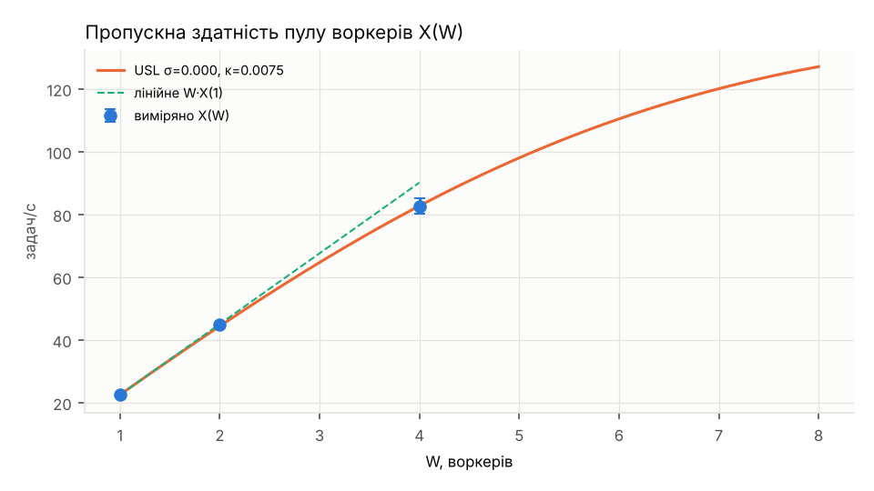
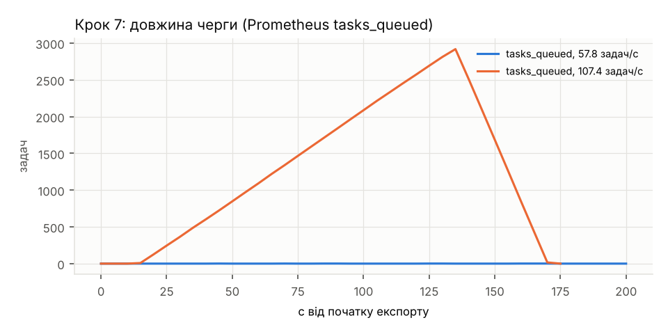
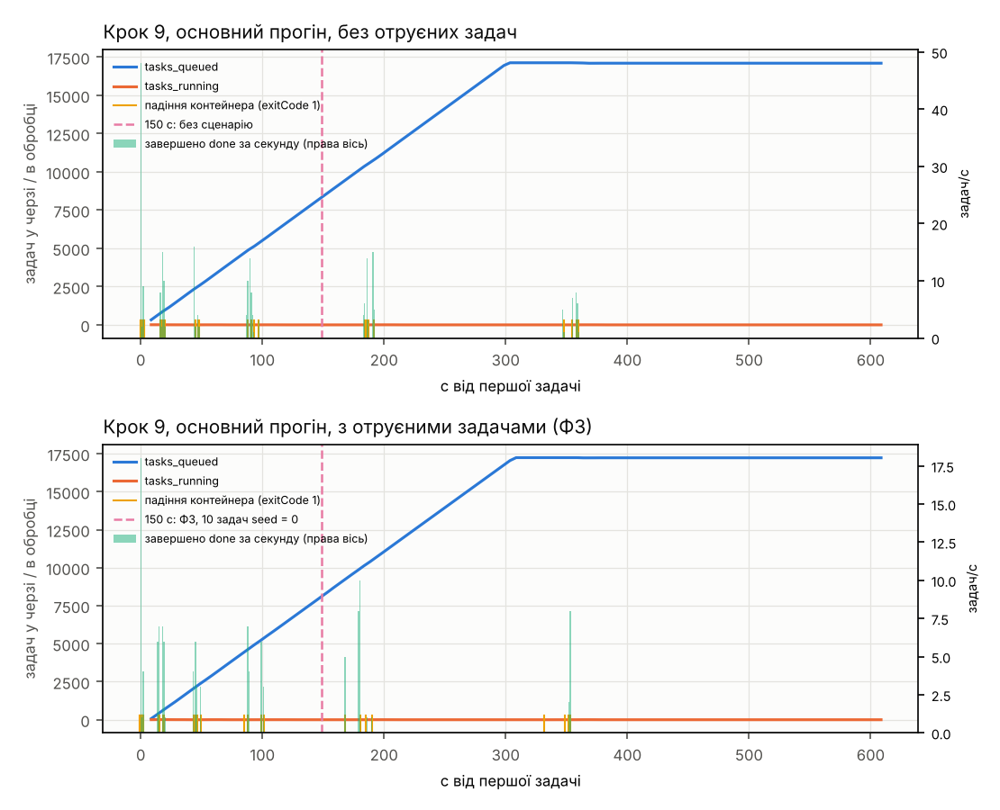
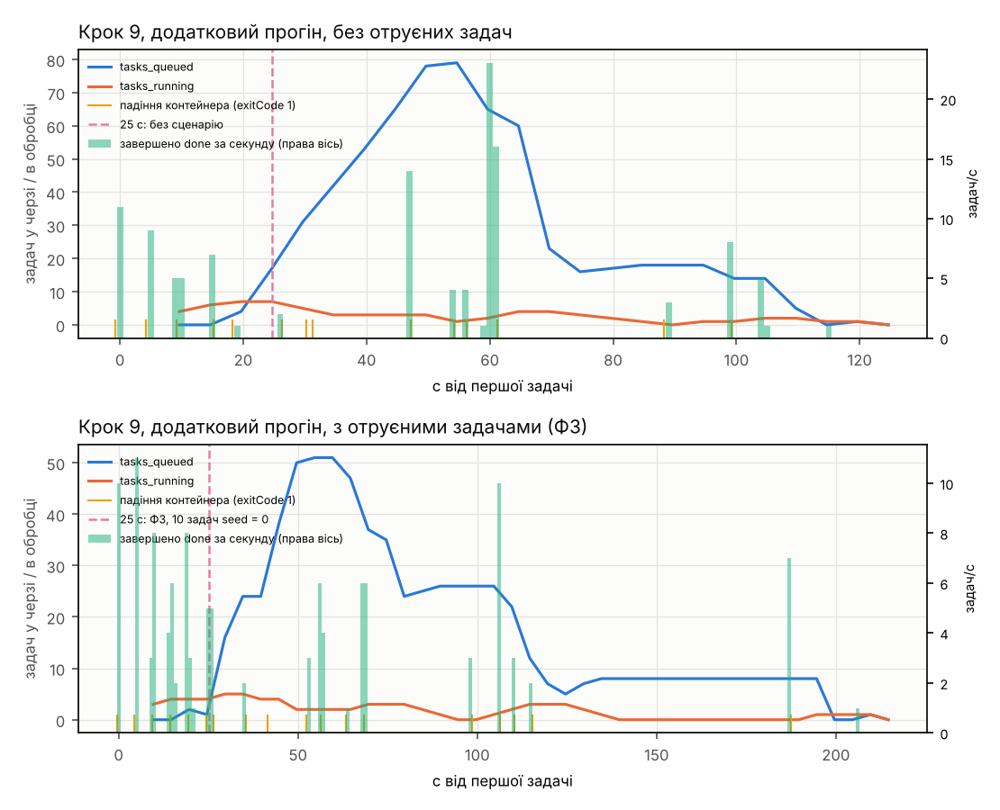

<div align="center">

# Лабораторна робота №4
## «Черга задач і пул воркерів: синхронізація через PostgreSQL»

Дисципліна: «Високопродуктивні розподілені обчислювальні системи»

**Варіант №25**

</div>

| | |
|---|---|
| **Виконав:** | студент Тарасенко І.О. |

---

## Зміст

- [Параметри варіанта 25](#параметри-варіанта-25)
- [Тестовий стенд і звідки беруться числа](#тестовий-стенд-і-звідки-беруться-числа)
- [Крок 1. Таблиці, ендпоінти, вимірювачі](#крок-1-таблиці-ендпоінти-вимірювачі)
- [Крок 2. Воркер, t_io і t_cpu](#крок-2-воркер-t_io-і-t_cpu)
- [Крок 3. Наївне захоплення](#крок-3-наївне-захоплення)
- [Крок 4. FOR UPDATE SKIP LOCKED і FOR UPDATE](#крок-4-for-update-skip-locked-і-for-update)
- [Крок 5. Lease, heartbeat, fencing token](#крок-5-lease-heartbeat-fencing-token)
- [Крок 6. Пропускна здатність пулу X(W)](#крок-6-пропускна-здатність-пулу-xw)
- [Крок 7. Закон Літтла](#крок-7-закон-літтла)
- [Крок 8. Коректна зупинка](#крок-8-коректна-зупинка)
- [Крок 9. FAIL_RATE = 0.15 і сценарій Ф3](#крок-9-fail_rate--015-і-сценарій-ф3)
- [Крок 10. Додаткова вимога Д6: скасування задач](#крок-10-додаткова-вимога-д6-скасування-задач)
- [Що виправлено під час налаштування і вимірювань](#що-виправлено-під-час-налаштування-і-вимірювань)
- [Висновки](#висновки)
- [Інструкція запуску](#інструкція-запуску)
- [Використання генеративних моделей](#використання-генеративних-моделей)

---

## Параметри варіанта 25

| Параметр | Значення |
|---|---|
| Сутність, ресурс | учасники клінічного дослідження, `/trial-participants` |
| Кількість воркерів R (з ЛР 3) | **4** |
| Розмір зрізу S | **256 × 256**, 4096 рівнів |
| Квантилі вікна q_lo / q_hi | **0.02 / 0.98** |
| Інтервал опитування T_poll | **10 мс** |
| Тривалість lease L | **15 с** (heartbeat кожні L/3 = 5 с) |
| Сценарій відмови | **Ф3**: 10 задач з seed = 0, на якому крок обробки викидає виняток |
| Додаткова вимога | **Д6**: `DELETE /tasks/{id}` — queued → cancelled, running → прапорець, який воркер перевіряє між проходами обробки |

## Тестовий стенд і звідки беруться числа

Кластер ЛР 3 (k3d: 1 server + 2 agent, k3s v1.31.4, Docker Desktop на WSL 2, i5-12450H), до якого
додано таблиці черги (міграція `002_create_tasks.sql`), ендпоінти задач у web і Deployment `worker`
(окремий образ `trials-worker:lab4`). web — 2 репліки, HPA з ЛР 3 вимкнено. Стан кластера перед
вимірюваннями — `results/lab4/setup.md` (вузли, поди, ресурси і змінні воркера, міграції,
`\d tasks`, `\d task_results`, цілі Prometheus: web — 2, worker, postgres-exporter — UP).

Усі прогони запускає `loadtest/lab4.py`. Для кожного кроку він пише `results/lab4/<крок>.md` —
кожна дія і кожне очікування з міткою часу і командою — і `<крок>.json` з числами. Перед кожним
прогоном воркери масштабуються до 0, таблиці очищуються і піднімаються свіжі поди, тож у прогін
не потрапляють залишки попереднього, а лічильники `/metrics` і RESTARTS починаються з нуля.
Часові межі прогонів беруться з годинника бази (`clock_timestamp()`), у якому записані
`created_at`/`started_at`/`finished_at`. Сирі дані (рядки `tasks` і `task_results`, журнали
воркерів, ряди Prometheus, вивід `kubectl get pods -w`) — у `results/lab4/raw/`, журнал усіх
команд — `results/lab4/logs/lab4.log`, зведення — `results/lab4/summary.md`.

**Кожна величина взята з джерела, яке названо в завданні:**

| Величина | Джерело |
|---|---|
| t_io, t_cpu (крок 2) | гістограма воркера `worker_task_duration_seconds{step}` (sum/count з `/metrics` пода); для перевірки — та сама гістограма в Prometheus і поля `*_ms` журналу |
| D (кроки 3–4) | рядки `task_results` з однаковим `task_id` **або** більше одного рядка `done` у журналах воркерів |
| p99 захоплення (кроки 4, 6) | гістограма воркера `worker_task_duration_seconds{step="claim"}` |
| порожні захоплення (крок 4) | лічильник воркера `worker_claims_total{result="empty"}` |
| рядки з `wait_event_type = 'Lock'` | `pg_stat_activity`, знімок щосекунди (одна сесія `psql` з `\watch 1`) |
| X(W) (крок 6) | `tasks.finished_at`, посекундно за останні 30 с до спорожнення черги |
| транзакції/с і CPU бази (крок 6) | `pg_stat_database_xact_commit + xact_rollback` (postgres-exporter), `container_cpu_usage_seconds_total` пода db-0 (cAdvisor) |
| λ, W_q (крок 7) | рядки `tasks`, створені в останні 120 с |
| L_q (крок 7) | середнє ряду `tasks_queued` у Prometheus (query_range) |
| коди завершення (кроки 8–9) | `kubectl get pods -w` (стан `terminated` контейнера) і рядки `exit` журналу воркера |
| RESTARTS (крок 9) | `kubectl get pods`, стовпчик RESTARTS (вивід збережено у звіті кроку) |

---

## Крок 1. Таблиці, ендпоінти, вимірювачі

`tasks` (id, record_id → trial_participants, status, seed, attempts, max_attempts = 3, token,
lease_until, worker_id, created_at, started_at, finished_at, cancel_requested,
cancel_requested_at; CHECK на статус і seed; індекс `(status, created_at)`) і `task_results`
(task_id — первинний ключ, token, worker_id, result JSONB). Ендпоінти — `app/tasks.py`.
Фоновий цикл кожної репліки web кожні 5 с повертає в чергу задачі зі спливлим lease і оновлює
вимірювачі `tasks_queued` і `tasks_running`.

| Запит | Очікувано | Отримано |
|---|---|---|
| `POST /trial-participants/1/tasks` | 202 + Location | **202** |
| `POST /trial-participants/999999/tasks` | 404 | **404** |
| `GET /tasks/1` | 200 | **200** |
| `GET /tasks/999999` | 404 | **404** |
| `GET /tasks?status=queued&limit=2&offset=1` | 200 | **200** |
| `GET /tasks?status=bad` | 400 | **400** |

Після створення 5 задач (воркерів 0) Prometheus показав `tasks_queued = 5` для обох реплік web, і
в таблиці в той самий момент `queued = 5` (`results/lab4/step1_api.md`).

## Крок 2. Воркер, t_io і t_cpu

Воркер (`worker/worker.py`, образ `worker/Dockerfile`) — один процес, одна задача за раз:
захоплення → отримання запису `GET /trial-participants/{id}` від web → обробка синтетичного
зрізу 256×256 (генератор LCG, гістограма 4096 рівнів, вікно за квантилями 0.02/0.98, чистий Python) →
запис результату. Конфігурація — змінні середовища, `WORKER_ID` — імʼя пода через Downward API.
Метрики: `worker_tasks_total{result}`, `worker_claims_total{result}`,
`worker_task_duration_seconds{step}`, `worker_tasks_in_flight`. Deployment `worker` без поля
replicas, requests.cpu 250m, limits 500m / 512Mi, terminationGracePeriodSeconds 30, PodMonitor
зі збором кожні 5 с. Генератор (`loadtest/stepgen.py --target task`) надсилає
`POST /trial-participants/{id}/tasks` для перших ста записів і зберігає id створених задач.

20 задач на одному воркері (`results/lab4/step2.md`):

| Крок | Гістограма воркера, мс | Prometheus, мс | Журнал, мс |
|---|---|---|---|
| fetch (GET запису) | 1.65 | 1.60 | 1.65 |
| process (обробка зрізу) | 33.54 | 34.12 | 33.54 |
| store (транзакція завершення + результат) | 7.75 | 7.14 | 7.75 |

**t_io = fetch + store = 9.40 мс, t_cpu = 33.54 мс.**

## Крок 3. Наївне захоплення

`SELECT` найстаршої задачі в статусі queued, потім окремий `UPDATE` на running, без транзакції і
блокувань; результат — `INSERT` без `ON CONFLICT`; первинний ключ `task_results` тимчасово
замінено індексом `ix_task_results_task_id` (видно в `step3.md`). 4 воркери, 300 задач зі
швидкістю 100 за секунду, до порожньої черги.

| T_poll | n | Рядків у task_results | Дублі за таблицею | Дублі за журналами | **D** |
|---|---|---|---|---|---|
| 10 мс | 300 | 335 | 33 | 33 | **0.110** |
| 1 мс | 300 | 344 | 41 | 41 | **0.137** |

Обидва джерела дали однакові множини задач (задач, що є дублем лише за одним джерелом, — 0). Приклад: задачу 1 (T_poll = 1 мс) взяли всі чотири
воркери, і в `task_results` чотири рядки з різними `worker_id`. Коротший інтервал опитування
збільшує D: коли в черзі зʼявляється задача, більше вільних воркерів встигають прочитати той самий
рядок між `SELECT` і `UPDATE` одного з них.

## Крок 4. FOR UPDATE SKIP LOCKED і FOR UPDATE

Захоплення — одна команда `UPDATE … WHERE id = (SELECT … ORDER BY created_at LIMIT 1 FOR UPDATE
SKIP LOCKED) RETURNING …`, первинний ключ `task_results` повернуто. Та сама серія (4 воркери,
300 задач, 100/с, T_poll = 1 мс):

| Захоплення | D | Помилок дубля ключа | p99 захоплення, мс | Порожніх захоплень | Макс. рядків Lock у pg_stat_activity |
|---|---|---|---|---|---|
| FOR UPDATE SKIP LOCKED | **0** | 0 | 2.48 | 5 930 | 0 (8 знімків) |
| FOR UPDATE | **0** | 0 | 2.47 | 6 189 | 0 (8 знімків) |

p99 і кількість порожніх захоплень — це різниця знімків `/metrics` усіх подів від старту
генератора до порожньої черги. Ті самі метрики через Prometheus дали p99 2.41 / 2.40 мс, а
порожніх захоплень 24 170 / 24 511: `increase()` на вікні у 15 с захоплює ще й секунди до і після
серії, коли черга вже порожня і кожен воркер щомілісекунди отримує порожній результат. Тому для
лічильника за серію взято точну різницю знімків. Обидва числа є у `step4.md`.

Обидва варіанти коректні: рядок блокується в тій самій команді, що його змінює. Без SKIP LOCKED
воркери, що прийшли по ту саму голову черги, чекають на блокування рядка, а після його звільнення
підзапит з `LIMIT 1` уже не повертає рядок (його статус став running) — звідси на 4 % більше
порожніх захоплень (6 189 проти 5 930). Помітного очікування блокувань при цьому навантаженні
немає: при 100 задачах за секунду черга майже порожня, а команда захоплення триває ≈ 1–2 мс, тож
очікування коротші за мілісекунди. Знімки раз на секунду (як вимагає завдання) їх не застали —
максимум 0 в обох прогонах, p99 захоплення однаковий. Для подальших кроків повернуто SKIP LOCKED і
T_poll = 10 мс.

## Крок 5. Lease, heartbeat, fencing token

Захоплення встановлює `lease_until = now + 15 с`, збільшує `attempts` і `token`. Heartbeat кожні
5 с продовжує lease з умовою `token = $токен AND status = 'running'`. Фоновий цикл web кожні 5 с
повертає задачі зі спливлим lease у queued, а після `max_attempts` — у failed. Завершення — одна
транзакція: `UPDATE tasks SET status='done' … WHERE id = $1 AND token = $2` і, лише якщо рядок
оновлено, `INSERT INTO task_results … ON CONFLICT DO NOTHING`.

**Чому не `kill -STOP 1`.** У контейнері воркера PID 1 — `tini` (див. `worker/Dockerfile`), воркер —
його дочірній процес. Спершу виконано саме команду із завдання (`step5.md`):

```text
kubectl exec worker-7f87c4cfbc-smtwz -- sh -c 'kill -STOP 1'
PID 1: /sbin/tini -- python worker.py State: S (sleeping)
PID 7: python worker.py State: S (sleeping)
```

За наступні 3 с цей воркер записав ще 80 результатів. Ядро не доставляє SIGSTOP процесу з PID 1
його простору імен PID, якщо сигнал надіслано зсередини цього простору (init захищений від
сигналів, для яких він не має обробника, а для SIGSTOP обробника не буває). Так само було б і з
воркером у ролі PID 1. Тому далі зупинено сам процес воркера:
`kill -STOP $(cat /tmp/worker.pid)` (стан `T (stopped)` перед відновленням є у `step5.md`).

**Перевірка на 2 воркерах і 100 задачах:**

| Величина | Значення |
|---|---|
| Зупинено | `worker-7f87c4cfbc-smtwz` о 18:36:50.036 (UTC, годинник бази) |
| Задача в обробці на момент зупинки | **19** |
| attempts / token до | **1 / 1** |
| attempts / token після | **2 / 2**, статус done |
| Завершив | **`worker-7f87c4cfbc-whk8h`** (захопив о 18:37:08.066, завершив о 18:37:08.091) |
| `kill -CONT` | о 18:37:20.927, через 30.9 с = 2·L |
| Рядків у task_results для задачі 19 | **1** (token 2, worker-7f87c4cfbc-whk8h) |

Рядки журналу зупиненого воркера після відновлення:

```text
{"event": "zero_rows", "op": "heartbeat", "task_id": 19, "token": 1, "msg": "heartbeat оновив 0 рядків: задача вже не належить цьому воркеру"}
{"event": "zero_rows", "op": "store", "task_id": 19, "token": 1, "msg": "завершення оновило 0 рядків: токен застарів, результат не записано"}
```

## Крок 6. Пропускна здатність пулу X(W)

**400 задач у черзі, як у завданні.** Пул спорожнює таку чергу за 17.4 с (W = 1), 8.8 с (W = 2) і
4.6 с (W = 4), тож вікна «останні 30 с до спорожнення» не існує:

| W | Час спорожнення 400 задач, с | X = 400 / час, задач/с |
|---|---|---|
| 1 | 17.42 | 22.96 |
| 2 | 8.83 | 45.29 |
| 4 | 4.59 | 87.22 |

**Основне вимірювання** — та сама процедура, але з чергою на ≈ 45 с роботи пулу (1 000, 2 000 і
4 000 задач, оцінка з кроку 2). Вікно 30 с до спорожнення тоді лежить у сталому режимі:

| W | X(W), задач/с | σ посекундно | C(W) | p99 захоплення, мс | Транзакцій/с бази | CPU пода бази, ядер | CPU воркера, ядер |
|---|---|---|---|---|---|---|---|
| 1 | **22.53** | 0.57 | 1.000 | 23.5 | 148 | 0.061 | 0.50 |
| 2 | **44.80** | 0.71 | 1.988 | 19.1 | 283 | 0.092 | 0.50 |
| 4 | **82.60** | 2.47 | 3.666 | 25.8 | 511 | 0.172 | 0.47 |



**Порівняння з моделлю:** 1 / (t_io + t_cpu + T_poll/2) = 1 / (9.40 + 33.54 + 5) мс = **20.9 задач/с**;
виміряне X(1) = **22.5** (+8 %). Доданок T_poll/2 — середнє очікування при порожній черзі; тут
черга не порожня, і воркер одразу захоплює наступну задачу, тож замість 5 мс він втрачає лише час
успішного захоплення (t_claim = 2.65 мс за журналом кроку 2): 1 / (t_io + t_cpu + t_claim) =
21.9 задач/с, на 3 % від виміряного.

**USL** (за X(1), X(2), X(4)): σ = 0 (оцінка вийшла відʼємною і обмежена нулем), κ = 0.0075,
**W\* = √((1 − σ)/κ) ≈ 11.6**. На трьох точках оцінка груба, але тенденція чітка: до 4 воркерів
пул масштабується майже лінійно (C(4) = 3.67), а база далека від межі — 0.17 ядра і 511 транзакцій/с
при 4 воркерах. Кожен воркер упирається у свою квоту 0.5 ядра: CPU воркера 0.47–0.50 ядра.
Звідси й p99 захоплення 19–26 мс проти 2.5 мс на кроці 4: при повністю зайнятій квоті CFS
пригальмовує процес до наступного 100-мс періоду, і короткий запит захоплення чекає разом з ним.

## Крок 7. Закон Літтла

**0.7·X(R) = 57.8 задач/с, 180 с**, вікно — останні 120 с (`step7.md`):

| Величина | Значення |
|---|---|
| λ (створено задач за секунду у вікні) | **57.79** задач/с |
| W_q (середнє started_at − created_at для 6 935 задач вікна) | **4.40 мс** |
| λ · W_q | **0.254** |
| L_q (середнє ряду `tasks_queued`) | **0.146** |
| Розбіжність | **43 %** |

Розбіжність спричинена вимірювачем, а не законом. `tasks_queued` — знімок довжини черги в момент
оновлення раз на 5 с у кожній репліці web: у вікні ≈ 48 знімків (2 × 24), майже всі 0 або 1. Для
величини, що в середньому дорівнює 0.25 і набуває значень 0/1, стандартне відхилення ≈ 0.43, а
стандартна похибка середнього з 48 знімків ≈ 0.06; 0.146 і 0.254 відрізняються на ≈ 1.7 похибки,
тобто в межах похибки вибірки. Для перевірки та сама величина порахована точно — як середня за часом
кількість задач у статусі queued за рядками `tasks` у тому самому вікні: **0.254**, тобто λ·W_q
збігається з точним L_q.

**1.3·X(R) = 107.4 задач/с, 120 с:** на кінець генерації в черзі **2 879** задач
(≈ (107.4 − 82.6) · 120 = 2 976, тобто черга росте зі швидкістю надлишку інтенсивності). W_q перших
100 задач — **0.114 с**, останніх 100 — **34.96 с**: при перевантаженні час очікування росте без
меж, доки йде генерація.



## Крок 8. Коректна зупинка

За SIGTERM воркер перестає захоплювати нові задачі, завершує задачу в обробці і виходить з кодом 0.
Якщо задача не завершилась за `SHUTDOWN_DEADLINE` = 25 с (< terminationGracePeriodSeconds = 30 с),
воркер повертає її в чергу (`UPDATE tasks SET status='queued' … WHERE id = $1 AND token = $2`). Під
прогоном 0.7·X(R) = 57.8 задач/с протягом 120 с на 40-й секунді виконано
`kubectl rollout restart deployment/worker` (rollout тривав 6.7 с):

| Величина | Значення |
|---|---|
| Коди завершення контейнерів (`kubectl get pods -w`) | **0, 0, 0, 0** (reason Completed) |
| Рядки журналу | у кожного з 4 старих подів `shutdown` → `exit code 0` через 5–67 мс |
| Задач, повернутих у чергу воркерами | **0** |
| Задач у статусі failed | **0** |
| Задач з більше ніж одним результатом | **0** |
| Задач з attempts > 1 | **0** (усі 6 936 задач — attempts = 1) |

Задача обробляється ≈ 45 мс, тож за SIGTERM воркер завжди встигає її завершити, і повертати в
чергу нічого не довелось. Шлях повернення перевірено на кроці 10 (скасування між проходами
використовує ту саму перевірку між проходами обробки).

## Крок 9. FAIL_RATE = 0.15 і сценарій Ф3

Після обробки і до запису результату воркер з імовірністю 0.15 виконує `os._exit(1)`. Kubernetes
перезапускає контейнер; задача лишається в running до спливання lease (15 с) і повертається в
чергу фоновим циклом web.

### Основний прогін (як у завданні)

4 воркери, 0.7·X(R) = 57.8 задач/с, 300 с, сценарій на 150-й секунді; два прогони — без отруєних
задач і з Ф3 (`step9.md`):

| Прогін | RESTARTS | Падінь (exitCode 1) | attempts > 1 / f | failed / f³ | > 1 результату | X, задач/с | X(R) |
|---|---|---|---|---|---|---|---|
| без Ф3 | **24** | 28 | 0.0014 / 0.15 | 0 / 0.0034 | 0 | **0.79** | 82.6 |
| з Ф3 | **24** | 28 | 0.0013 / 0.15 | 0.00006 / 0.0034 | 0 | **0.40** | 82.6 |



Пул зупинився. Воркер падає в середньому через 1/f ≈ 7 задач, тобто за перші секунди після старту.
Kubernetes після кожного падіння збільшує паузу перед перезапуском (CrashLoopBackOff: 10, 20, 40, 80,
160 с, далі 300 с). За `kubectl get pods -w` паузи між падіннями кожного пода — **2, 17, 27, 44, 96,
168 с** (у решти подів — майже ті самі, `summary.md`). Наприкінці всі 4 поди в CrashLoopBackOff
з RESTARTS = 6. Пул встигав обробити лише кілька задач після кожного перезапуску, тож
X = 0.4–0.8 задач/с замість 82.6. У черзі лишилось 17 тисяч задач, 98.6–99.3 % задач жодного разу
не захоплено. Тому частки attempts > 1 і failed тут не можна порівнювати з f і f³: знаменник — переважно
задачі, яких ніхто не брав. Отруєні задачі, створені на 150-й секунді, стояли в черзі за ≈ 8 600
задачами і до кінця прогону лишились queued з attempts = 0. Значень Ф3 цей прогін не дає. Задач з
більше ніж одним результатом — 0 в обох прогонах.

### Додатковий прогін: скінченне навантаження

Щоб отримати величини, які просить завдання, виконано додатковий прогін (`loadtest/lab4.py step9b`,
`step9b.md`). Параметри ті самі: FAIL_RATE = 0.15, 4 воркери, свіжі поди. Але навантаження скінченне:
12 задач кожні 5 с протягом 50 с (120 задач), у прогоні з Ф3 на 25-й секунді створено 10 задач з
seed = 0. Прогін триває, доки кожна задача не досягне кінцевого статусу.

| Прогін | RESTARTS | Падінь | Розподіл attempts (звичайні задачі) | attempts > 1 / f | failed / f³ | Захоплень на задачу done / 1/(1 − f) | > 1 результату | p50 / p99 очікування, с | До останньої задачі, с |
|---|---|---|---|---|---|---|---|---|---|
| без Ф3 | **16** | 18 | 1: 106, 2: 10, 3: 4 | **0.117** / 0.15 | **0** / 0.0034 | 1.15 / 1.18 | **0** | 26.3 / **69.1** | 117 |
| з Ф3 | **20** | 21 | 1: 102, 2: 15, 3: 3 | **0.150** / 0.15 | **0** / 0.0034 | 1.18 / 1.18 | **0** | 1.8 / **147.6** | 207 |

Частка задач з attempts > 1 — 0.117 і 0.150 при очікуваних 0.15 (стандартна похибка на 120 задачах
±0.033). Середня кількість захоплень задачі до успіху — 1.15 і 1.18 при 1/(1 − f) = 1.18. f³ = 0.0034
означає 0.4 задачі зі 120, тож 0 задач failed — очікуваний результат. Дублів результату немає: кожна
задача, захоплена повторно після падіння, отримала новий token, а запис іде через
`ON CONFLICT DO NOTHING` в одній транзакції із завершенням.

**Ф3 — отруєні задачі (id 73–82):**

| Величина | Значення |
|---|---|
| Статус після прогону | **failed** — усі 10 |
| attempts | **3** (= max_attempts) — усі 10 |
| Від створення до failed | **9.96–10.11 с** |

Отруєна задача не валить воркер: виняток перехоплюється, задача повертається в чергу з attempts + 1,
а після третьої спроби переходить у failed. Усі три спроби вклались у кілька мілісекунд: для задачі 73
остання спроба почалась через 9.961 с після створення, а failed записано через 9.964 с. Решта ≈ 10 с —
очікування вільного воркера: у момент сценарію поди саме були в паузі CrashLoopBackOff.

**p99 очікування решти задач:** 147.6 с з отруєними задачами проти 69.1 с без них. Різниця не від
отруєних задач: усі 10 разом забрали в пулу лише 30 захоплень по кілька мілісекунд. Її дає кількість
і момент падінь контейнерів — 21 проти 18 падінь, і в прогоні з Ф3 один под дійшов до пʼятої паузи
CrashLoopBackOff (89 с). Хвіст очікування визначає саме те, на якій паузі опинились поди, коли в
черзі ще були задачі.



На діаграмах — `tasks_queued` і `tasks_running` (Prometheus), кількість задач done за секунду
(`tasks.finished_at`), моменти падінь контейнерів (`kubectl get pods -w`) і пунктиром момент
сценарію.

## Крок 10. Додаткова вимога Д6: скасування задач

`DELETE /tasks/{id}` у транзакції з `SELECT … FOR UPDATE`. Задачу в queued одразу переведено в
cancelled (**200**); для задачі в running встановлюється `cancel_requested = true` і
`cancel_requested_at` (**202**), а воркер між проходами обробки (k = `PROCESS_PASSES`) перевіряє
прапорець і переводить задачу в cancelled без запису результату. Для задач в інших статусах ендпоінт
повертає 409, для неіснуючої задачі — 404 (у прогоні нижче ці випадки не виникали).

Для перевірки `PROCESS_PASSES = 100` (задача done триває 4.1–4.3 с), 4 воркери, 40 задач; скасовано 20 задач у
running і 5 у queued (`d6.md`):

| Величина | Значення |
|---|---|
| Коди відповідей | 202 × 20 (running), 200 × 5 (queued) |
| Від запиту скасування до зупинки обробки (`cancel_requested_at` → `finished_at`), 20 задач | **p50 = 24.9 мс, p99 = 72.1 мс** |
| Статус скасованих задач | **cancelled** — усі 25 |
| Результатів у скасованих задач | **0** |
| Решта задач | 15 done |

Час зупинки обмежений тривалістю одного проходу обробки (4.2 с / 100 ≈ 42 мс):
воркер помічає прапорець на межі найближчого проходу.

---

## Що виправлено під час налаштування і вимірювань

1. **`kill -STOP 1` не зупиняє воркер** — це не помилка коду, а властивість простору імен PID
   (крок 5). Команду із завдання виконано і показано, що процес лишився активним (80 задач за
   3 с); зупинку виконано за PID воркера з `/tmp/worker.pid`.
2. **400 задач замало для вікна 30 с** (крок 6) — прогін з 400 задачами залишено як є, а
   основне вимірювання зроблено з чергою на ≈ 45 с роботи пулу.
3. **Коди завершення контейнерів спершу не розібрались.** Оркестратор читає
   `kubectl get pods -w -o jsonpath=…`; роздільник `\t` у шаблоні на Windows не дійшов до
   kubectl, і поля вийшли розділеними пробілами. Сам вивід збережено повністю
   (`raw/step8_pods_watch.tsv`, `raw/step9_*_pods_watch.tsv`). Розбір виправлено (тепер роздільник
   `|`, старий формат теж читається), коди в цьому звіті отримано з тих самих файлів.
4. **Основний прогін кроку 9 не дав значень Ф3 і порівняння з f, f³** через CrashLoopBackOff
   (див. крок 9). Він залишений у звіті як результат, а для потрібних величин виконано додатковий
   прогін зі скінченним навантаженням і тими самими FAIL_RATE і R.
5. **Лічильник порожніх захоплень через Prometheus завищений** (крок 4): `increase()` на короткому
   вікні захоплює секунди без задач. Для лічильника за серію взято різницю знімків `/metrics` подів;
   обидва значення наведено.
6. **Журнали воркерів після падінь неповні** (крок 9): `kubectl logs` показує лише поточний
   контейнер, тож рядки контейнерів, що впали, недоступні. Тому значення кроку 9 рахуються за
   таблицями `tasks` / `task_results` і `kubectl get pods`, а не за журналами.

---

## Висновки

1. Наївне захоплення (SELECT, потім UPDATE) дублює роботу: D = 0.110 при T_poll = 10 мс і 0.137
   при 1 мс; частіше опитування — більше дублів.
2. `FOR UPDATE SKIP LOCKED` і `FOR UPDATE` в одній команді з UPDATE прибирають дублі (D = 0). При
   100 задачах за секунду різниця між ними мала: без SKIP LOCKED на 4 % більше порожніх
   захоплень, а очікувань блокувань у знімках раз на секунду не видно.
3. Lease з heartbeat і fencing token коректно забирають задачу у «завислого» воркера: задача 19
   після 2·L зупинки виконана іншим воркером з token 2, один результат, а зупинений воркер після
   відновлення двічі записав у журнал «0 рядків» і результат не записав.
4. Пул масштабується майже лінійно: X(1) = 22.5, X(2) = 44.8, X(4) = 82.6 задач/с, W\* ≈ 11.6;
   межа — квота 0.5 ядра кожного воркера, база використовує 0.17 ядра. Модель
   1/(t_io + t_cpu + T_poll/2) = 20.9 задач/с занижує X(1) на 8 %, бо при непорожній черзі
   очікування T_poll/2 немає.
5. Закон Літтла: λ·W_q = 0.254 і точне середнє довжини черги за рядками tasks — 0.254; виміряне за
   5-секундними знімками `tasks_queued` L_q = 0.146 (розбіжність 43 %) — це похибка вибірки з ≈ 48
   знімків. Вище X(R) черга росте на ≈ (λ − X(R)) задач за секунду, і W_q — від 0.1 до 35 с.
6. Коректна зупинка: rollout restart під навантаженням — 4 коди виходу 0, жодної втраченої,
   повторної чи failed задачі.
7. При FAIL_RATE = 0.15 на задачу Kubernetes вимикає пул: CrashLoopBackOff з паузами до 168 с, і
   при сталому потоці 57.8 задач/с пропускна здатність падає з 82.6 до 0.4–0.8 задач/с. На
   скінченному навантаженні частка повторних спроб (0.117 і 0.150) і середня кількість захоплень
   (1.15–1.18) відповідають f = 0.15 і 1/(1 − f) = 1.18, дублів немає.
8. Ф3: отруєні задачі не валять воркер і через 3 спроби переходять у failed (≈ 10 с, з яких
   кілька мілісекунд — самі спроби). На p99 очікування решти задач впливають падіння контейнерів, а
   не отруєні задачі.
9. Д6: скасування задачі в обробці зупиняє її за p50 = 25 мс, p99 = 72 мс, без результату.

---

## Інструкція запуску

```powershell
powershell -ExecutionPolicy Bypass -File scripts\k8s\deploy.ps1 -SkipCluster   # кластер ЛР 3 уже є
# або без -SkipCluster для нового кластера, потім: py loadtest/seed.py
py loadtest/lab4.py all            # кроки 1–10 (≈ 1 год), докази — results/lab4/<крок>.md
py loadtest/lab4.py step9b         # додатковий прогін кроку 9
py loadtest/lab4_analyze.py        # results/lab4/summary.md, fig/*.png
```

Окремий крок — `py loadtest/lab4.py setup|api|step2|…|step9|d6|step9b` (step7–step9 беруть X(R) з
`results/lab4/step6.json`).

| Що | Де |
|---|---|
| Міграція черги | `migrations/002_create_tasks.sql` |
| Ендпоінти задач, вимірювачі, повернення задач | `app/tasks.py` |
| Воркер і його образ | `worker/worker.py`, `worker/Dockerfile` |
| Deployment і PodMonitor воркера | `k8s/worker.yaml` |
| Генератор (режим створення задач) | `loadtest/stepgen.py --target task` |
| Вимірювання | `loadtest/lab4.py` |
| Аналіз і діаграми | `loadtest/lab4_analyze.py` |
| Результати | `results/lab4/` (`*.md`, `*.json`, `raw/`, `fig/`, `summary.md`, `logs/lab4.log`) |

---

## Використання генеративних моделей

Воркер, ендпоінти, маніфести, оркестратор і аналіз написано з допомогою Claude. Що перевірено і
змінено після моделі:

1. Перед прогонами на кластері всі кроки оркестратора пройдено на локальному стенді з підміненим
   `kubectl`. Знайдено і виправлено: залишки задач попереднього кроку потрапляли в журнали
   наступного (тепер кожен прогін починається з 0 воркерів і порожніх таблиць); крок без
   первинного ключа ламав наступні кроки (ключ тепер відновлюється перед кожним прогоном).
2. Після першого запуску перевірив усі `<крок>.md`. Побачив, що коди завершення контейнерів
   порожні, і знайшов причину в роздільнику jsonpath на Windows (пункт 3 розділу «Що виправлено»).
3. Основний прогін кроку 9 не дав значень Ф3 (пул зупинився в CrashLoopBackOff); додано і виконано
   додатковий прогін, основний залишено у звіті без змін.
4. Розбіжність закону Літтла перевірено незалежним розрахунком середньої довжини черги за рядками
   `tasks` (0.254 = λ·W_q).
