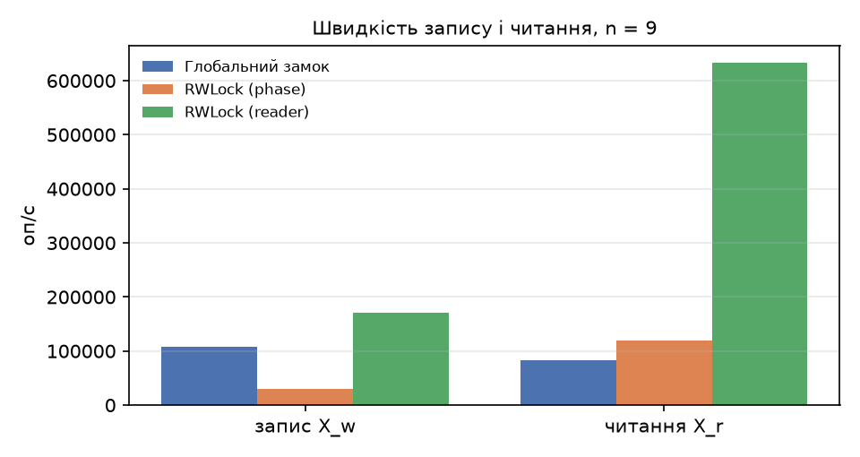
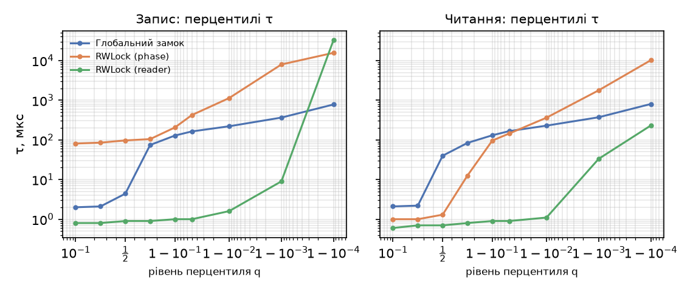

<div align="center">

# Лабораторна робота №5
## «Проєктування потокобезпечної структури даних»

Дисципліна: «Високопродуктивні розподілені обчислювальні системи»

**Варіант №25**

</div>

| | |
|---|---|
| **Виконав:** | студент Тарасенко І.О. |

---

## Зміст

- [Параметри варіанта 25](#параметри-варіанта-25)
- [Крок 1. Стенд](#крок-1-стенд)
- [Крок 2. Глобальний замок](#крок-2-глобальний-замок)
- [Крок 3. RWLock](#крок-3-rwlock)
- [Операції потоків](#операції-потоків)
- [Крок 4. Метрики прискорення](#крок-4-метрики-прискорення)
- [Крок 5. Порівняння доступу до даних](#крок-5-порівняння-доступу-до-даних)
- [Додатково: RWLock з перевагою читачів](#додатково-rwlock-з-перевагою-читачів)
- [Висновки](#висновки)
- [Інструкція запуску](#інструкція-запуску)
- [Використання генеративних моделей](#використання-генеративних-моделей)

---

## Параметри варіанта 25

| Параметр | Значення |
|---|---|
| Структура | **С5**: агрегатор статистики інтенсивностей з **25** кошиками |
| Операція запису | `add(value)`, value — ціле від 0 до 24 (рівномірно) |
| Операція читання | `snapshot()` → 25 лічильників кошиків, кількість, сума, сума квадратів |
| Кількість потоків n | **9**: n_w = ⌈9/2⌉ = **5** записують (потоки 1, 3, 5, 7, 9), n_r = ⌊9/2⌋ = **4** читають (2, 4, 6, 8) |
| Інваріанти | сума кошиків дорівнює кількості в кожному знімку; після прогону кількість дорівнює кількості викликів `add` |

## Крок 1. Стенд

Мова — Python (CPython 3.12.3). Код: структура і способи синхронізації — `lab5/aggregator.py`,
стенд — `lab5/stand.py`, обробка — `lab5/analyze.py`.

**Структура.** Стан — список із 25 цілих (кошики), `count`, `total`, `total_sq` і службовий
лічильник `mutations` (кількість змін стану). `add(v)` збільшує кошик `v`, суму, суму квадратів і
лише після цього `count`: якби читання перетнулось у часі із записом, знімок побачив би
`sum(bins) ≠ count`, тож інваріант кожного знімка заразом перевіряє взаємне виключення.
`snapshot()` лише копіює поля. Готових потокобезпечних колекцій немає, використовуються тільки
`threading.Lock` і `threading.Condition`.

**Потоки.** 9 потоків з номерами 1–9 стартують через `threading.Barrier`. Непарні виконують лише
`add`, парні — лише `snapshot`, без пауз. Аргумент (`random.Random(1000 + номер).randrange(25)`)
генерується до `t_call`. Для кожної операції потік записує:

* `t_call` — `perf_counter_ns()` перед викликом операції, тобто до запиту замка;
* `t_acq` — повертає сама операція: момент одразу після отримання замка;
* `t_ret` — після повернення з операції, тобто після звільнення замка.

τ = t_ret − t_call, t_wait = t_acq − t_call. Прогін: 1 с прогріву, потім D = 10 с; операція
належить до виміру, якщо її `t_call` лежить у вікні [t_start, t_start + D). Читач після кожного
знімка (поза τ) перевіряє `sum(bins) == count` і те, що `count` не зменшується. Кожен прогін — в
окремому процесі Python, тричі; у таблицях — медіана трьох прогонів, окремо для кожної величини.
Перцентилі — за формулою p_q = τ_(⌈q·N⌉) з упорядкованого масиву всіх τ ролі.

**X_1** — окремий режим: один потік по черзі виконує операції за шаблоном W R W R W R W R W
(5 записів : 4 читання = n_w : n_r) під тим самим замком, 1 с прогріву + 10 с.

**Таблиця 1. Стенд**

| Параметр | Значення |
|---|---|
| n | 9 |
| n_w | 5 |
| n_r | 4 |
| Мова і версія | CPython 3.12.3 (Windows 11), GIL увімкнено, `sys.getswitchinterval()` = 5 мс |
| Логічних ядер | 12 (Intel Core i5-12450H) |
| X_1, оп/с | **1 808 494** (глобальний замок), **1 116 906** (RWLock) |
| Інваріанти після прогонів кроків 2 і 3 | **виконано в усіх 9 прогонах**: count = кількості викликів `add`, `mutations` = кількості викликів `add`, сума кошиків = count, сума і сума квадратів дорівнюють зваженим сумам кошиків; знімків із сумою кошиків ≠ count — **0 з 7 076 095**, знімків зі зменшеним count — 0 |

Розкид трьох прогонів X_1: 1 816 543 / 1 808 494 / 1 772 489 (G), 1 116 906 / 1 062 408 / 1 126 389 (RW).
Усі числа — `results/lab5/tables.md`, сирі дані кожного прогону — `results/lab5/raw/*.json`,
журнал — `results/lab5/logs/lab5.log`.

## Крок 2. Глобальний замок

`GlobalLockAggregator`: один `threading.Lock`, який `add` і `snapshot` тримають на весь час роботи
зі структурою. Умовні змінні для С5 не потрібні (операцій, що чекають на стан, немає).

t_cs,w і t_cs,r виміряно одним потоком без конкуренції (режим `tcs`: 1 с прогріву, потім 10 с лише
записів і 10 с лише читань, час від отримання замка до моменту перед його звільненням).

**Таблиця 2. Глобальний замок**

| Роль | Операцій за D | X, оп/с | p50, мкс | p99, мкс | Найбільший t_wait, мс | w | cv | t_cs, мкс |
|---|---|---|---|---|---|---|---|---|
| Запис | 1 086 600 | 108 660 | 4.40 | 220.20 | 1.22 | 0.933 | 0.003 | 0.199 |
| Читання | 832 861 | 83 286 | 39.80 | 228.30 | 1.28 | 0.934 | 0.006 | 0.154 |
| Разом | 1 921 561 | 192 156 | 33.50 | 223.10 | 1.28 | 0.934 | 0.020 | 0.179 (t̄_cs) |

t̄_cs = (5 · 0.199 + 4 · 0.154) / 9 = **0.179 мкс**, межа 1 / t̄_cs = **5 589 161 оп/с**.

Рядок «Разом» — медіана величин, порахованих по всіх 9 потоках разом у кожному прогоні (тому
кількість операцій у ньому не обовʼязково дорівнює сумі медіан рядків «Запис» і «Читання»).

## Крок 3. RWLock

**Реалізація і політика** (`RWLock` в `lab5/aggregator.py`). Замок побудовано на одному мʼютексі
`threading.Lock` і двох `threading.Condition` над ним: читачі чекають на `_rcond`, писці — на
`_wcond`, тож звільнення будить лише ту сторону, яка може продовжити. Стан: кількість читачів
усередині, прапорець писця, кількості писців і читачів, що чекають, і `_pass` — кількість читачів,
пропущених поперед писців.

Політика (`phase`, основна для вимірювань):

1. писець чекає, поки всередині є писець або читачі, або поки не увійшли читачі, яких пропустив
   попередній писець (`_pass > 0`);
2. новий читач чекає, поки всередині писець **або є писці, що чекають** — перевага писцям: потік
   читачів, що не вривається, не може заморити писця;
3. коли писець звільняє замок, **усі читачі, що чекали в цей момент, входять раніше за наступного
   писця** (`_pass = кількість читачів, що чекають`) — тому й писці не можуть заморити читачів.

Отже, запис і читання чергуються фазами: один запис, потім пачка читачів, що накопичилась за час
цього запису. Така сама політика в `sync.RWMutex` мови Go.

**Читання не змінює полів структури** — перевірено двічі: (1) самоперевірка стенду (`selftest`):
стан після 100 000 викликів `snapshot()` побітово такий самий, як до них, для обох способів
синхронізації; (2) у кожному прогоні після завершення `mutations` (збільшується лише в `add`) і
`count` дорівнюють кількості викликів `add`. Самоперевірка також підтвердила, що два читачі
тримають замок одночасно, писець чекає, поки читачі всередині, а новий читач чекає, якщо писець уже
чекає.

**Таблиця 3. RWLock**

| Роль | Операцій за D | X, оп/с | p50, мкс | p99, мкс | Найбільший t_wait, мс | w | cv |
|---|---|---|---|---|---|---|---|
| Запис | 297 055 | 29 706 | 96.90 | 1 132 | 30.23 | 0.972 | 0.024 |
| Читання | 1 188 223 | 118 822 | 1.30 | 362.40 | 28.27 | 0.931 | 0.026 |
| Разом | 1 485 278 | 148 528 | 2.90 | 527.20 | 30.89 | 0.954 | 0.716 |

## Операції потоків

**Таблиця 4. Операції потоків за D секунд** (медіана трьох прогонів)

| Потік | Роль | Глобальний замок | RWLock |
|---|---|---|---|
| 1 | запис | 217 227 | 58 940 |
| 2 | читання | 207 221 | 303 507 |
| 3 | запис | 218 072 | 60 910 |
| 4 | читання | 209 310 | 305 856 |
| 5 | запис | 216 546 | 59 567 |
| 6 | читання | 208 950 | 284 200 |
| 7 | запис | 217 671 | 60 663 |
| 8 | читання | 207 937 | 308 128 |
| 9 | запис | 216 676 | 58 884 |

## Крок 4. Метрики прискорення

**Таблиця 5. Метрики прискорення**

| Метрика | Формула | Значення |
|---|---|---|
| S(n), глобальний замок | X(G) / X_1 = 192 156 / 1 808 494 | **0.106** |
| E(n), глобальний замок | S(n) / n | **0.012** |
| S(n), RWLock | X(RW) / X_1 = 148 528 / 1 116 906 | **0.133** |
| E(n), RWLock | S(n) / n | **0.015** |
| S_w | X_w(RW) / X_w(G) = 29 706 / 108 660 | **0.273** |
| S_r | X_r(RW) / X_r(G) = 118 822 / 83 286 | **1.427** |
| S_Σ | X(RW) / X(G) = 148 528 / 192 156 | **0.773** |
| ρ, завантаженість глобального замка | X(G) · t̄_cs = 192 156 · 0.179 мкс | **0.034** |

**X(G) і межа 1 / t̄_cs.** X(G) = 192 156 оп/с — лише 3.4 % межі 5.59 млн оп/с: глобальний замок
утримується 3.4 % часу (ρ = 0.034), тобто впирається стенд не в критичну секцію. Водночас потоки
проводять в очікуванні замка 93 % часу (w = 0.93). Обидва числа узгоджуються, якщо подивитись на
розподіл τ (діаграма нижче): він двомодовий. Близько половини операцій займають ≈ 2 мкс — замок
вільний, і потік, що вже виконується, одразу його бере. Решта — 70–230 мкс: потік чекає, поки
операційна система розбудить його після звільнення замка і він знову отримає GIL. Замок у цей час
здебільшого вільний — час іде на передачу керування між потоками, а не на роботу зі структурою.

**Чому S(n) < 1.** У CPython з GIL байт-код Python у кожен момент виконує лише один потік, тож 9
потоків не можуть працювати швидше за один, навіть на 12 ядрах. Один потік (X_1) не платить за
передачу GIL і замка між потоками, а 9 потоків платять за неї майже в кожній другій операції. Тому
X(G) у 9.4 раза менше за X_1 (S = 0.106), а ефективність E ≈ 0.01. З RWLock S(n) трохи більше
(0.133), але лише тому, що X_1 з RWLock менше: кожна операція RWLock двічі бере внутрішній мʼютекс
(вхід і вихід), і один потік з RWLock повільніший на 38 % (1.12 млн проти 1.81 млн оп/с).

## Крок 5. Порівняння доступу до даних

**Таблиця 6. Порівняння доступу до даних**

| Показник | Глобальний замок: запис | Глобальний замок: читання | RWLock: запис | RWLock: читання | RW / G: запис | RW / G: читання |
|---|---|---|---|---|---|---|
| X, оп/с | 108 660 | 83 286 | 29 706 | 118 822 | 0.273 | 1.427 |
| x, на один потік ролі, оп/с | 21 732 | 20 822 | 5 941 | 29 706 | 0.273 | 1.427 |
| p50, мкс | 4.40 | 39.80 | 96.90 | 1.30 | 22.02 | 0.033 |
| p99, мкс | 220.20 | 228.30 | 1 132 | 362.40 | 5.14 | 1.59 |
| h = p99 / p50 | 50.05 | 5.74 | 11.51 | 281.92 | 0.230 | 49.15 |
| Найбільший t_wait, мс | 1.22 | 1.28 | 30.23 | 28.27 | 24.83 | 22.15 |
| w | 0.933 | 0.934 | 0.972 | 0.931 | 1.041 | 0.997 |
| cv | 0.003 | 0.006 | 0.024 | 0.026 | 9.26 | 4.74 |
| φ, частка ролі в усіх операціях | 0.565 | 0.433 | 0.200 | 0.800 | 0.354 | 1.846 |





**Читання прискорилось (S_r = 1.43).** З глобальним замком читачі отримували доступ на рівних з
писцями (x_r ≈ x_w ≈ 21 тис. оп/с на потік, частка читань 0.43 при 4 з 9 потоків), і медіанне
читання чекало передачі замка (p50 = 39.8 мкс). З RWLock читачі, що накопичились за час запису,
входять разом і не чекають один одного: **p50 читання впав з 39.8 до 1.3 мкс** (у 30 разів) — більша
частина читань тепер проходить без передачі керування. Саме це поле таблиці 6 пояснює приріст;
частка очікування читачів майже не змінилась (w 0.934 → 0.931), бо тепер вони чекають пачкою, поки
пише писець. Ціна — хвіст: p99 читання виріс з 228 до 362 мкс, а h — з 5.7 до 282: рідкісні читання
чекають кількох фаз записів.

**Запис сповільнився (S_w = 0.27).** Після кожного запису політика пропускає вперед пачку читачів, і
наступний писець чекає, поки вони вийдуть, а потім — пробудження. Тому **p50 запису виріс з 4.4 до
96.9 мкс** (у 22 рази), частка очікування писців — з 0.933 до 0.972, а найбільший t_wait — з 1.2 до
30 мс. Частка записів серед усіх операцій упала з 0.565 до 0.200: з RWLock на один запис припадає
чотири читання, хоча писців 5, а читачів 4. Рівномірність між потоками однієї ролі залишилась
високою (cv 0.024–0.026 проти 0.003–0.006): жоден потік не голодував, але з глобальним замком
передача замка «по колу» вирівнювала потоки майже ідеально.

**Сумарно** RWLock зменшив X на 23 % (S_Σ = 0.77): у Python читачі не можуть виконуватись паралельно
через GIL, тож перевага RWLock — лише в тому, що читачі не чекають один одного, а вона менша за
втрати писців і за подвійну вартість входу і виходу з RWLock.

## Додатково: RWLock з перевагою читачів

Для порівняння виконано три прогони з політикою `reader`: читач чекає, лише поки писець
всередині, писець — поки всередині є хоч один читач (`py lab5/stand.py run --lock rw --policy reader`).

| Роль | Операцій за D | X, оп/с | p50, мкс | p99, мкс | Найбільший t_wait, мс | w | cv |
|---|---|---|---|---|---|---|---|
| Запис | 1 709 969 | 170 997 | 0.90 | 1.60 | **1 187** | 0.861 | 0.204 |
| Читання | 6 330 186 | 633 019 | 0.70 | 1.10 | 264.13 | 0.483 | 0.054 |
| Разом | 8 059 339 | 805 934 | 0.70 | 1.20 | 1 187 | 0.693 | 0.701 |

X у 4.2 раза більше, ніж з глобальним замком: читачі тримають замок, перекриваючись, і потоку, що
виконується, майже ніколи не доводиться чекати пробудження іншого. Але писці голодують: найбільший
t_wait запису — **1.19 с**, тобто 12 % тривалості вимірювання один запис не міг отримати замок; між
писцями розкид великий (cv = 0.204, за потоками 269–398 тис. операцій). p99 у таблиці малий, бо
довгі очікування рідкісні: 99.99-й перцентиль запису в першому прогоні — 32 мс. Тому для основних вимірювань обрано
політику без голодування.

---

## Висновки

1. Структура С5 з глобальним замком і з RWLock коректна: у всіх 9 прогонах виконуються інваріанти,
   жоден із 7.08 млн знімків не перетнувся із записом, читання не змінює полів структури.
2. У CPython з GIL прискорення від потоків немає: S(n) = 0.106 (глобальний замок) і 0.133 (RWLock),
   E(n) ≈ 0.01. Глобальний замок зайнятий лише 3.4 % часу (ρ = 0.034, X — 3.4 % межі 1 / t̄_cs), а
   потоки 93 % часу чекають: обмеження — передача GIL і замка між потоками, а не критична секція.
3. Заміна глобального замка на RWLock (політика з чергуванням фаз, як у Go) **прискорила читання**
   (S_r = 1.43, p50 читання 39.8 → 1.3 мкс) і **сповільнила запис** (S_w = 0.27, p50 запису
   4.4 → 96.9 мкс, найбільший t_wait 1.2 → 30 мс); сумарно X зменшилась на 23 %.
4. RWLock з перевагою читачів дає в 4.2 раза більше X, але писець чекає до 1.19 с — голодування,
   від якого захищає основна політика.

---

## Інструкція запуску

```powershell
py lab5/stand.py all               # selftest, t_cs, X_1 (G, RW), 3 × n-потокові прогони G і RW, 3 × RW reader
py lab5/analyze.py                 # results/lab5/tables.md, tables.json, fig/*.png
py lab5/stand.py run --lock global # окремий прогін: друкує кількість операцій кожного потоку, X_w, X_r, p50, p99, t_wait, w
py lab5/stand.py run --lock rw [--policy reader]
py lab5/stand.py x1 --lock global|rw
```

| Що | Де |
|---|---|
| Структура, глобальний замок, RWLock | `lab5/aggregator.py` |
| Стенд | `lab5/stand.py` |
| Таблиці і діаграми | `lab5/analyze.py` |
| Результати | `results/lab5/` (`tables.md`, `raw/*.json`, `fig/`, `host.json`, `logs/lab5.log`) |

---

## Використання генеративних моделей

Структуру, RWLock, стенд і обробку написано з допомогою Claude. Що перевірено:

1. Першу версію RWLock (одна умовна змінна і `notify_all`) замінено версією з двома умовними
   змінними над одним мʼютексом, щоб звільнення будило лише ту сторону, яка може продовжити.
2. Коректність синхронізації перевіряється на кожному знімку (сума кошиків = count, count не
   зменшується) і після кожного прогону; окрема самоперевірка підтверджує, що читання не змінює
   стану, а політика RWLock поводиться як описано.
3. Перед вимірами стенд перевірено короткими прогонами (0.3 с), числа таблиць 5 і 6 перераховано з
   таблиць 2 і 3 вручну.
