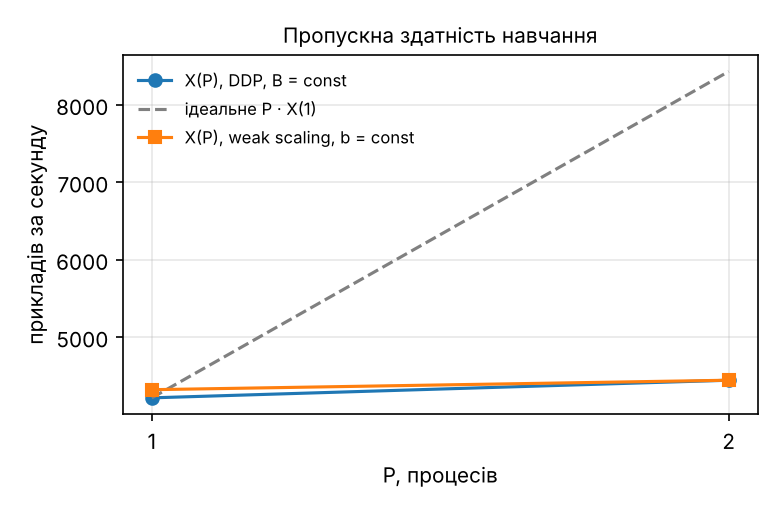
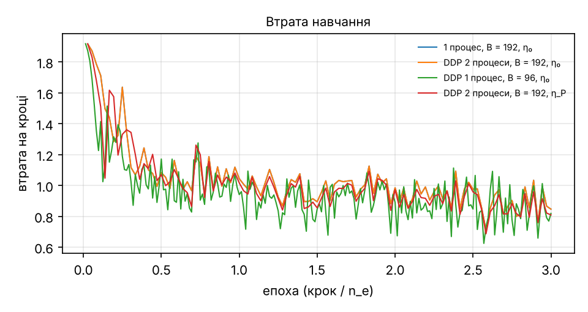

<div align="center">

# Лабораторна робота №6
## «Розподілене навчання нейромережі за даними на CPU»

Дисципліна: «Високопродуктивні розподілені обчислювальні системи»

**Варіант №25**

</div>

| | |
|---|---|
| **Виконав:** | студент Тарасенко І.О. |

---

## Зміст

- [Параметри варіанта 25](#параметри-варіанта-25)
- [Стенд і код](#стенд-і-код)
- [Крок 1. Навчання в одному процесі](#крок-1-навчання-в-одному-процесі)
- [Крок 2. Синхронізація градієнтів: вручну і DDP](#крок-2-синхронізація-градієнтів-вручну-і-ddp)
- [Крок 3. Strong scaling](#крок-3-strong-scaling)
- [Крок 4. Weak scaling і якість за різних глобальних батчів](#крок-4-weak-scaling-і-якість-за-різних-глобальних-батчів)
- [Крок 5. Контрольні точки, відмова і відновлення](#крок-5-контрольні-точки-відмова-і-відновлення)
- [Що виправлено під час налаштування і вимірювань](#що-виправлено-під-час-налаштування-і-вимірювань)
- [Висновки](#висновки)
- [Інструкція запуску](#інструкція-запуску)
- [Використання генеративних моделей](#використання-генеративних-моделей)

---

## Параметри варіанта 25

| Параметр | Значення |
|---|---|
| Датасет | **Д1**: DermaMNIST (дерматоскопія), K = 7 класів, C = 3 канали, 28 × 28 |
| Ширина мережі | **Ш2**: c1 / c2 / h = 32 / 64 / 256 |
| P_max | **2** |
| Глобальний батч B | **192** |
| Інтервал контрольних точок K_c | **20** кроків |
| Крок відмови s_f | **50** |
| Спільне для всіх | N = 7000 перших прикладів train, тест — увесь test (2005), SGD з моментом 0.9, η₀ = 0.02, n_ep = 3, `torch.manual_seed(0)` перед створенням моделі |

## Стенд і код

| Файл | Що робить |
|---|---|
| `lab6/common.py` | дані (`load_split` із завдання), мережа `Net`, формула n_params, параметри варіанта, відомості про машину |
| `lab6/train.py` | власний цикл навчання: один процес без `torch.distributed`; P процесів з ручним all-reduce або DDP; вимірювання швидкості; перевірка еквівалентності градієнтів; контрольні точки, відновлення під час старту, імітація відмови |
| `lab6/torchrun_win.py` | `torchrun` (`torch.distributed.run`, ті самі аргументи) з двома виправленнями для Windows — див. розділ «Що виправлено» |
| `lab6/lab6.py` | запускає всі прогони (бекенд gloo, статична адреса 127.0.0.1), пише `results/lab6/raw/*.json`, вивід кожного прогону — `results/lab6/logs/*.out`, журнал — `results/lab6/logs/lab6.log` |
| `lab6/analyze.py` | таблиці 1–6 (`results/lab6/tables.md`) і графіки (`results/lab6/fig/`) |

Готових обгорток навчання (Trainer, accelerate, Lightning) немає. DataLoader кожного процесу —
`DistributedSampler(num_replicas=P, rank=r, shuffle=True, seed=0)`, `sampler.set_epoch(epoch)` перед
кожною епохою, `batch_size = b = B / P`, `drop_last=True`, `num_workers=0`. Прогін в одному процесі
теж бере індекси з `DistributedSampler(num_replicas=1, rank=0)`: тоді його батч k збігається з
обʼєднанням батчів k обох процесів у прогоні на P = 2 (процес r бере позиції r, r + 2, … тієї самої
перестановки), і втрату двох прогонів можна порівняти крок у крок.

**Методика вимірів швидкості:** 10 кроків прогріву, далі 50 вимірюваних кроків; `t_step` — медіана
часу 50 кроків процесу 0 (`time.perf_counter()`), X = 50 · B / t, де t — сума тривалостей цих 50 кроків.
t_step,ns — окремий прогін, у якому forward і backward виконуються всередині `model.no_sync()`, після
нього навчання не продовжується.

**Таблиця 1. Стенд**

| Процесор | Фізичних ядер C_phys | Логічних ядер | Памʼять, ГБ | ОС | Python | PyTorch | n_th |
|---|---|---|---|---|---|---|---|
| 12th Gen Intel Core i5-12450H (4 P-ядра з HT + 4 E-ядра) | 8 | 12 | 16.9 | Windows 11 (10.0.26200) | 3.12.3 | 2.15.0+cpu | **4** = ⌊8 / 2⌋ |

| Датасет | K | C | c1 / c2 / h | n_params | M, МіБ | N | B | P_max |
|---|---|---|---|---|---|---|---|---|
| DermaMNIST | 7 | 3 | 32 / 64 / 256 | **824 263** | **3.14** | 7 000 | 192 | 2 |

n_params = 9·3·32 + 32 + 9·32·64 + 64 + 49·64·256 + 256 + 256·7 + 7 = 824 263, і саме стільки
параметрів порахувала модель (`assert` у коді); 8 тензорів параметрів; M = 4 · n_params = 3 297 052
байт. n_th = 4 задано через `torch.set_num_threads(4)` на початку `train.py` для всіх прогонів, включно з
однопроцесними.

## Крок 1. Навчання в одному процесі

Без `torch.distributed`, B = 192, η₀ = 0.02, 3 епохи по n_e = ⌊7000 / 192⌋ = 36 кроків (108 кроків):
**ACC = 0.6793, AUC = 0.8271** (`results/lab6/raw/s1_single_train.json`). Швидкість: t_step = 42.91 мс,
**X(1) = 4 325 прикл./с**. Це перший рядок таблиці 2.

## Крок 2. Синхронізація градієнтів: вручну і DDP

**Ручна синхронізація.** Ваги процесу 0 розсилаються `dist.broadcast(p.data, src=0)` для кожного
параметра, після `loss.backward()` для кожного з 8 тензорів виконується
`dist.all_reduce(p.grad, op=SUM)` і `p.grad /= P`. t_sync — час від першого виклику all-reduce до
повернення з останнього.

**Еквівалентність.** На першому батчі навчальної частини (приклади 0–191) процес 0 обчислив градієнт g
на всіх 192 прикладах, а кожен із двох процесів — на прикладах r, r + 2, … (по 96) з подальшою ручною
синхронізацією. Найбільше відношення max |g − ḡ| / max |g| за тензорами — **7.64·10⁻⁶** (тензор
`features.0.weight`; для решти 6.4·10⁻⁸–5.2·10⁻⁶) — у межах очікуваних для float32 10⁻⁶–10⁻⁵.
Після 50 кроків суми ваг обох процесів у float64 (зібрані `all_gather`) однакові: 57.023291349540195,
**різниця 0**.

**DDP** з типовим розміром кошика (25 МіБ, перший — 1 МіБ). Для перевірки, що прогін no_sync справді
вимикає обмін, у ньому теж зібрано суми ваг після 50 кроків: 56.48 і 38.87 — ваги процесів розійшлися,
як і має бути без обміну.

**Таблиця 2. Синхронізація градієнтів**

| Режим | t_step, мс | Час обміну на крок, мс | Частка кроку в обміні | X, прикл./с |
|---|---|---|---|---|
| 1 процес, батч B | 42.91 | 0 | 0 | 4 325 |
| 2 процеси, ручна синхронізація | 65.49 | 27.45 (t_sync) | 0.419 | 2 809 |
| 2 процеси, DDP | 40.97 | 4.59 (t_comm,exp) | 0.112 | 4 442 |
| 2 процеси, DDP, no_sync | 36.38 | 0 | 0 | 5 429 |

| max \|g − ḡ\| / max \|g\| | Різниця сум ваг між процесами після 50 кроків | ACC, 1 процес | ACC, DDP на 2 | AUC, 1 процес | AUC, DDP на 2 |
|---|---|---|---|---|---|
| 7.64·10⁻⁶ | 0 | 0.6793 | 0.6793 | 0.8271 | 0.8271 |

Втрата навчання DDP на 2 процесах відрізняється від втрати одного процесу на тих самих батчах щонайбільше
на 6.6·10⁻⁵ за всі 108 кроків (лише порядок додавання у float32), а ACC збігається до четвертого знака
(AUC 0.82715 в одному процесі і 0.82712 з DDP).

**Ручна синхронізація проти DDP.** Ручний цикл запускає 8 all-reduce один за одним і лише після
завершення backward, тож час кроку = обчислення + обмін: 27.4 мс із 65.5 мс (42 %), і два процеси
обробляють навіть менше прикладів за секунду, ніж один (2 809 проти 4 325). У t_sync процесу 0 входить
і очікування повільнішого процесу (див. крок 3). DDP складає градієнти в кошики й запускає all-reduce
кошика ще під час backward, тож відкритим лишається лише 4.6 мс (11 % кроку).

## Крок 3. Strong scaling

B = 192, b = 192 / P; прогін з P = 1 — через torchrun з DDP. Рядок P = 2 — прогони DDP з кроку 2.

**Таблиця 3. Strong scaling, B = const**

| P | b | t_step, мс | t_step,ns, мс | X, прикл./с | S | E | e | c |
|---|---|---|---|---|---|---|---|---|
| 1 | 192 | 42.77 | 45.41 | 4 215 | 1 | 1 | − | −0.062 ≈ 0 |
| 2 | 96 | 40.97 | 36.38 | 4 442 | **1.054** | **0.527** | **0.898** | **0.112** |
| 3 | — | — | — | — | — | — | — | — |
| 4 | — | — | — | — | — | — | — | — |

Рядки з P > P_max = 2 не заповнюються. Для P = 1 обміну немає (all-reduce в одному процесі нічого не
пересилає), тому c має дорівнювати 0; від'ємне значення −0.062 — розкид двох окремих прогонів
(середні 45.6 і 49.6 мс), тобто похибка вимірювання t_step ≈ 6 %.



Два процеси дають лише S = 1.05 замість 2, e = 0.90. Обмін пояснює лише малу частину: c = 0.11.
Основна причина видна з t_step,ns: без обміну крок процесу з b = 96 у прогоні на 2 процесах триває
36.4 мс, а той самий крок одного процесу з b = 96 — 20.8 мс (таблиця 4). Тобто обчислення кожного
процесу сповільнилось у 1.75 раза, коли поруч працює другий. У процесора i5-12450H 4 продуктивні
P-ядра і 4 енергоефективні E-ядра. З n_th = 4 один процес займає P-ядра, а другий отримує E-ядра,
повільніші приблизно вдвічі. До того ж обидва ділять одну кеш-памʼять і смугу памʼяті. У синхронному SGD
кожен крок чекає найповільнішого процесу, тому X(2) визначається процесом на E-ядрах. e(P), отримана
таким чином, — це «послідовна частка» не через обмін, а через нерівні ядра.

## Крок 4. Weak scaling і якість за різних глобальних батчів

b = B / P_max = 96, B_P = P · b.

**Таблиця 4. Weak scaling, b = const**

| P | B_P | t_step, мс | X, прикл./с | S_w | E_w |
|---|---|---|---|---|---|
| 1 | 96 | 20.81 | 4 320 | 1 | 1 |
| 2 | 192 | 40.97 | 4 442 | **1.028** | **0.514** |
| 3 | — | — | — | — | — |
| 4 | — | — | — | — | — |

Рядок P = 2 — з таблиці 3. Причина та сама, що в кроці 3: крок з тим самим b триває вдвічі довше
(41 проти 21 мс), бо другий процес працює на E-ядрах, а кожен крок чекає на нього.

**Якість.** Режим P = 2 з η₀ узято з кроку 2; ще два режими — P = 1 з b = 96 і η₀, і P = 2 з
η_P = η₀ · B_P / B₀ = 0.02 · 192 / 96 = **0.04** (лінійне правило, B₀ = b). Розігріву немає.

**Таблиця 5. Якість за різних глобальних батчів**

| Режим | B_P | η | Кроків оптимізатора за n_ep епох | ACC | AUC | Найбільша втрата за останню епоху |
|---|---|---|---|---|---|---|
| P = 1 | 96 | 0.02 | 216 | **0.6988** | **0.8537** | 1.1130 |
| P = 2, з кроку 2 | 192 | 0.02 | 108 | 0.6793 | 0.8271 | 1.0928 |
| P = 2 | 192 | 0.04 | 108 | 0.6828 | 0.8280 | 1.0302 |



З глобальним батчем 192 за ті самі 3 епохи модель отримує вдвічі менше оновлень ваг (108 проти 216), і
якість нижча: ACC 0.679 проти 0.699, AUC 0.827 проти 0.854. Лінійне правило (η = 0.04) частково
повертає втрачене: ACC 0.683, AUC 0.828, втрата останнього кроку 0.809 проти 0.847 з η₀, а найбільша
втрата за останню епоху — найменша з трьох (1.03). Розходження навчання немає: найбільша втрата за весь
прогін у всіх трьох режимах — на першому кроці (1.92), хоча на початку прогону з η = 0.04 видно
сплеск до 1.6 (діаграма). Рівня одного процесу з малим батчем правило не досягає: за 3 епохи 108 кроків
по 0.04 не замінюють 216 кроків по 0.02.

## Крок 5. Контрольні точки, відмова і відновлення

У навчання з DDP на 2 процесах додано контрольні точки кожні K_c = 20 кроків: їх пише лише процес 0
(модель, стан оптимізатора, епоха, номер батча в епосі, крок) у `ckpt.tmp`, потім `os.replace` на
`ckpt.pt`, далі `dist.barrier()`. Під час старту кожен процес читає `ckpt.pt`, якщо він є, відновлює
модель і оптимізатор, викликає `sampler.set_epoch(epoch)` і пропускає перші `step_in_epoch` батчів.
Процес з rank 1 на початку кроку 50 створює файл-позначку і завершується `os._exit(1)` без контрольної
точки. Запуск:

```text
torchrun --nnodes=1 --nproc_per_node=2 --max-restarts=1 --rdzv-backend=static
         --master-addr=127.0.0.1 --master-port=29660 --node-rank=0 train.py ...
```

(через `lab6/torchrun_win.py`, див. «Що виправлено»). Моменти подій записуються з `time.time()` у
`results/lab6/raw/s5_events.r*.jsonl`. Після відмови torchrun зупинив процес 0, запустив обидва процеси
повторно (`TORCHELASTIC_RESTART_COUNT = 1`), вони продовжили з кроку 40 і завершили всі 108 кроків.

**Таблиця 6. Відмова і відновлення**

| K_c | s_f | Крок останньої контрольної точки | Кроків виконано повторно | t_lost, с |
|---|---|---|---|---|
| 20 | 50 | **40** | **9** (кроки 41–49) | **4.09** |

| Крок | 48 | 49 | 50 | 51 | 52 | ACC після n_ep епох |
|---|---|---|---|---|---|---|
| Втрата, прогін з відмовою | 1.037955 | 1.020652 | 1.076050 | 0.895547 | 0.896559 | 0.6793 |
| Втрата, прогін без відмови | 1.037955 | 1.020652 | 1.076050 | 0.895547 | 0.896559 | 0.6793 |

t_lost = (t_f − t_c) + t_r = 0.41 + 3.69 = 4.09 с: від запису контрольної точки кроку 40 до відмови
пройшло 0.41 с (9 кроків), а від відмови до завершення першого кроку після відновлення — 3.69 с
(зупинка групи, запуск двох нових процесів Python з імпортом PyTorch, створення групи gloo, читання
контрольної точки, крок 41). Виконано повторно 9 кроків — близько до середніх K_c / 2 = 10.

Втрата прогону з відмовою збігається з втратою навчання без відмови (крок 2) **на всіх 108 кроках
точно** (найбільша різниця 0), так само й на повторно виконаних кроках 41–49 до відмови і після
відновлення; ACC 0.6793 і AUC 0.82712 однакові. Відновлене навчання пройшло ті самі приклади в тому
самому порядку з тим самим станом оптимізатора.

---

## Що виправлено під час налаштування і вимірювань

1. **libuv на Windows.** PyTorch для Windows зібрано без бібліотеки libuv, а `TCPStore`, через який
   процеси групи знаходять один одного, у PyTorch 2.15 типово її вимагає. Помилка
   `use_libuv was requested but PyTorch was built without libuv support` виникала двічі, і змінна
   `USE_LIBUV=0` не допомагала:
   * в агенті torchrun зі статичною адресою — тому `lab6/torchrun_win.py` перед викликом
     `torch.distributed.run.main()` підміняє `TCPStore` у модулі статичного рандеву на варіант з
     `use_libuv=False` (аргументи і поведінка torchrun ті самі);
   * у процесах навчання в `init_process_group` — тому `train.py` створює `TCPStore` сам з
     `use_libuv=False` (адреса, порт, номер процесу і кількість процесів — ті, що задав torchrun; для
     сховища агента — з префіксом `/worker/attempt_<номер перезапуску>`, як у стандартному шляху) і
     передає його в `init_process_group(backend="gloo", store=...)`.
2. **Прогін no_sync спершу вимірював не те.** У першій версії всередині `model.no_sync()` був лише
   `backward`, але DDP вирішує, чи робити обмін, ще в `forward`, тому обмін відбувався:
   t_comm,exp вийшло від'ємним (−0.6 мс), а суми ваг процесів після 50 кроків — однаковими. Forward
   перенесено всередину контексту; після цього ваги в прогоні no_sync розходяться (56.48 і 38.87), і
   t_comm,exp = 4.6 мс. Прогони переміряно.
3. **Перезапуск зависав.** На Windows torchrun зупиняє процеси сигналом `CTRL_C_EVENT`, який
   доставляється всім процесам консолі (зупинявся і сам скрипт запуску), а процес, заблокований в
   all-reduce gloo, на нього не реагує. `torchrun_win.py` зупиняє такий процес через `TerminateProcess`
   (аналог SIGKILL), а `lab6.py` запускає torchrun в окремій групі процесів.
4. Попередження `The client socket has failed to connect to [kubernetes.docker.internal]` — gloo бере
   імʼя машини, яке Docker Desktop записав у `hosts`, і з другої спроби підключається; на результати не
   впливає.

---

## Висновки

1. Паралелізм за даними відтворює крок одного процесу: середній градієнт двох процесів відрізняється
   від градієнта на всьому батчі на 7.6·10⁻⁶ від max |g|, ваги процесів після 50 кроків однакові,
   втрата за 108 кроків — у межах 6.6·10⁻⁵, ACC однакова (0.6793).
2. DDP приховує обмін: відкритий час обміну — 4.6 мс (11 % кроку) проти 27.4 мс (42 %) з ручним
   all-reduce по тензорах після backward; X — 4 442 проти 2 809 прикл./с.
3. На цьому процесорі 2 процеси майже не прискорюють навчання: S = 1.05, E = 0.53, e = 0.90 (strong),
   S_w = 1.03 (weak). Обмін — лише 11 % кроку; головне — гібридний процесор: другий процес з 4 потоками
   працює на E-ядрах, і обчислення кроку сповільнюється в 1.75 раза, а синхронний SGD чекає найповільнішого.
4. Більший глобальний батч за ту саму кількість епох погіршує якість (ACC 0.679 проти 0.699, AUC 0.827
   проти 0.854). Лінійне правило η_P = 0.04 частково компенсує це (ACC 0.683, нижча втрата наприкінці),
   розходження навчання немає.
5. Контрольні точки кожні 20 кроків: після відмови на кроці 50 повторено 9 кроків, втрачено 4.09 с
   (з них 3.69 с — перезапуск групи); навчання після відновлення побітово збігається з навчанням без відмови.

---

## Інструкція запуску

```powershell
py -m pip install torch numpy scikit-learn psutil matplotlib
py lab6/lab6.py prepare     # пакети, data/dermamnist.npz із Zenodo, host.json
py lab6/lab6.py check       # gloo + DDP на 2 процесах
py lab6/lab6.py all         # кроки 1–5 (~4 хв)
py lab6/analyze.py          # results/lab6/tables.md, fig/*.png
```

Окремі кроки — `py lab6/lab6.py step1` … `step5`. Датасет і контрольні точки в `.gitignore`
(DermaMNIST поширюється за CC BY-NC 4.0 і завантажується скриптом).

---

## Використання генеративних моделей

Цикл навчання, оркестратор і обробку написано з допомогою Claude. Що перевірено і виправлено:

1. Обробку таблиць перевірено на штучних даних до реальних прогонів.
2. Після першого запуску побачив від'ємний t_comm,exp і однакові ваги процесів у прогоні no_sync —
   знайдено помилку з `no_sync` (пункт 2 розділу «Що виправлено»), прогони переміряно.
3. Помилки запуску на Windows (libuv, зависання перезапуску) розібрано за виводом torchrun і виправлено
   без зміни логіки навчання; результат кроку 5 перевірено порівнянням втрат на всіх 108 кроках.
